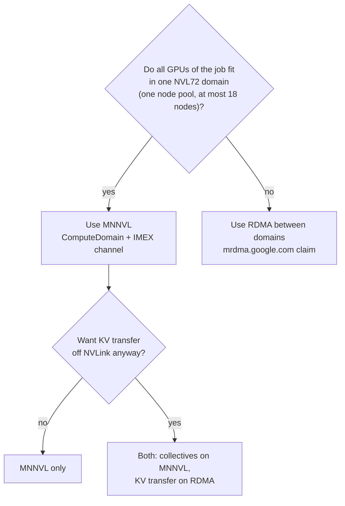
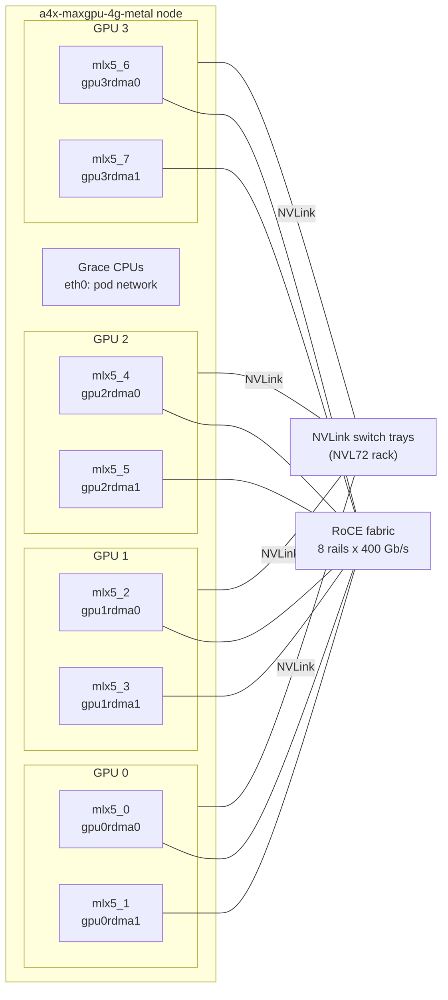
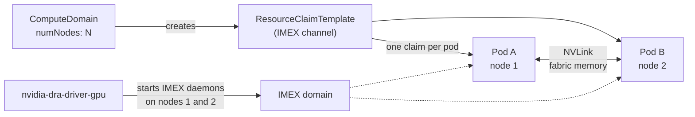
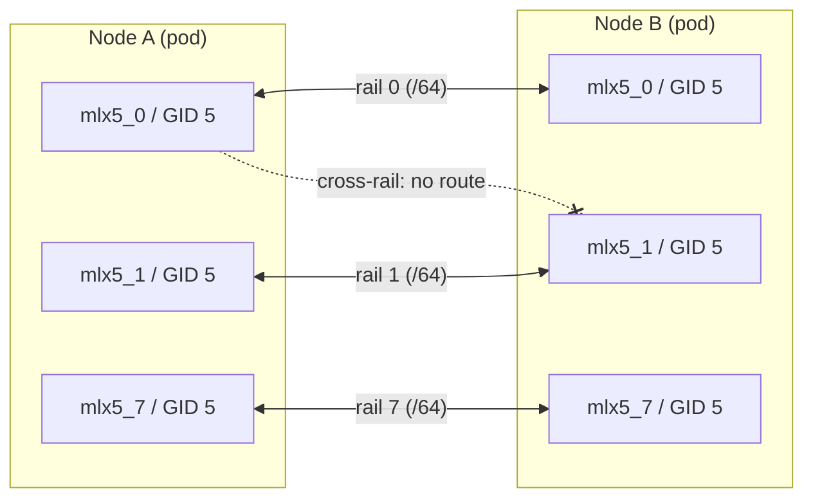
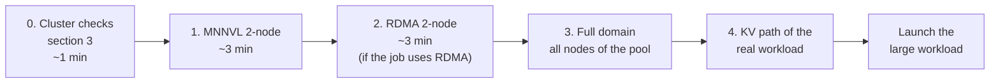

# MNNVL and RDMA on GKE A4X Max (GB300): Setup and Smoke Tests

This guide explains the two GPU fabrics of an A4X Max cluster, how to give a Kubernetes pod access to each one, and how to prove each fabric works before you launch a large job.

* **MNNVL** (multi-node NVLink) connects every GPU inside one NVL72 domain. It is the fastest path and the default for KV-cache transfer and collectives inside a domain.
* **RDMA** (RoCE over the eight 400 Gb/s NICs per node) connects nodes over Ethernet. Use it between NVL72 domains, or when you want KV transfer off NVLink.

Everything here was validated on a GKE A4X Max cluster on 2026-10-26 with the [smoke tests in this folder](smoke-tests/).

## Table of contents

* [1. Which fabric to use](#which-fabric)
* [2. Background](#background)
  * [2.1. One A4X Max node](#node)
  * [2.2. MNNVL and the NVL72 domain](#mnnvl-background)
  * [2.3. RDMA rails](#rdma-background)
  * [2.4. Side by side](#comparison)
* [3. Check the cluster](#cluster-checks)
* [4. Set up MNNVL in a pod](#setup-mnnvl)
* [5. Set up RDMA in a pod](#setup-rdma)
* [6. Smoke tests before a large workload](#smoke-tests)
  * [6.1. The test ladder](#ladder)
  * [6.2. MNNVL smoke test](#smoke-mnnvl)
  * [6.3. RDMA smoke test](#smoke-rdma)
  * [6.4. Scale to the full domain](#smoke-scale)
  * [6.5. Check the KV-transfer path of the real workload](#smoke-kv)
  * [6.6. Pre-launch checklist](#checklist)
* [7. Troubleshooting](#troubleshooting)
* [8. References](#references)

<a name="which-fabric"></a>
## 1. Which fabric to use



* **One domain, one fabric:** MNNVL is the simplest and fastest choice. Our DeepSeek-R1, DeepSeek-V4 and Nemotron-3-Ultra recipes keep all traffic on MNNVL.
* **Both fabrics:** you can keep NCCL collectives on NVLink and move only KV transfer to RDMA. Our [RDMA-KV report](../dynamo-disagg-sweep/reports/benchmark-report-rdma-kv.md) measured DeepSeek-R1 this way: output throughput per GPU landed between -1.4% and +7.6% of the MNNVL runs.
* **More than one domain:** NVLink does not reach across domains, so cross-domain traffic must use RDMA.

<a name="background"></a>
## 2. Background

<a name="node"></a>
### 2.1. One A4X Max node

An `a4x-maxgpu-4g-metal` node is an Arm (Grace) machine with 4 NVIDIA GB300 GPUs. Each GPU has two paths out of the node:

* NVLink to the NVLink switches of the rack, used by MNNVL.
* Two 400 Gb/s ConnectX RDMA NICs, `gpuNrdma0` and `gpuNrdma1`, used by RDMA. That is 8 NICs per node, each one its own rail.

Pod networking (`eth0`) uses a separate host NIC and carries only control traffic: Kubernetes, rendezvous and NCCL bootstrap.



<a name="mnnvl-background"></a>
### 2.2. MNNVL and the NVL72 domain

An NVL72 domain is one rack: 18 nodes, 72 GPUs, all joined by NVLink switches. Inside a domain, any GPU can read and write any other GPU's memory over NVLink, as if it were in the same machine.

* **One node pool is one domain.** On the clusters we used, each GB300 node pool sits in one NVL72 domain. The node label `cloud.google.com/gce-topology-subblock` identifies the domain: every node of a pool carries the same value, and different pools carry different values. Check yours with step 5 of [section 3](#cluster-checks).
* **IMEX makes cross-node memory sharing possible.** The NVIDIA IMEX daemon (Internode Memory EXchange) runs on each node of a domain. It exchanges memory handles so CUDA on one node can map memory that lives on another node.
* **The ComputeDomain wraps IMEX for Kubernetes.** The NVIDIA DRA driver (`nvidia-dra-driver-gpu`) watches `ComputeDomain` objects. For each one it starts IMEX daemons on the nodes the pods land on and hands every pod an IMEX channel device through a DRA `ResourceClaim`. A pod without that claim gets no cross-node NVLink, even when it runs in the right node pool.



What the libraries need on top of the channel:

| Library | Setting | Effect |
| :--- | :--- | :--- |
| NCCL | `NCCL_MNNVL_ENABLE=1`, `NCCL_CUMEM_ENABLE=1` | Collectives over multi-node NVLink, plus NVLS (NVLink SHARP) multicast |
| Mooncake (SGLang KV transfer) | `MC_FORCE_MNNVL=1`, `SGLANG_MOONCAKE_CUSTOM_MEM_POOL=True` | KV-cache transfer over NVLink |
| NIXL / UCX (KV transfer) | `UCX_TLS=cuda_copy,cuda_ipc,tcp`, `UCX_CUDA_IPC_ENABLE_MNNVL=y` | KV-cache transfer over NVLink through CUDA IPC |

<a name="rdma-background"></a>
### 2.3. RDMA rails

The 8 RDMA NICs of a node run RoCEv2 (RDMA over Converged Ethernet) at 400 Gb/s each, so a node has 8 x 400 Gb/s = 400 GB/s of RDMA bandwidth.

* **Rails are separate networks.** NIC `mlx5_k` on every node sits on rail `k`. Each rail is its own IPv6 /64 subnet, and there are no routes between rails. So `mlx5_3` on one node can reach `mlx5_3` on another node, but not `mlx5_5`.
* **DraNet hands the NICs to pods.** The DraNet DRA driver (`dra.net`) publishes the RDMA NICs in `ResourceSlices`. The DeviceClass `mrdma.google.com` selects NICs with `rdma == true`. A pod gets the NICs by claiming 8 devices from that class.
* **Pods get ipvlan children.** The node daemon `asapd-lite` configures the NICs (its IP-address step runs in ipvlan mode), and DraNet publishes a `gpuNipvlanM` child for each one. A pod that claims them gets 8 `gpuNipvlanM` interfaces, each with its own address on that rail, and sees the matching `mlx5_*` devices under `/sys/class/infiniband`.
* **Pick the right GID.** RoCE addresses each endpoint by GID. Inside a pod, each NIC lists 8 GIDs. Only index 5 is usable from the pod: the RoCEv2 GID on the pod's own `gpuNipvlanM` address. The others are link-local (`fe80::`) or belong to the host's `gpuNrdmaM`.

GID table of `mlx5_0` read inside a pod that claimed the NICs:

```text
gid[0] fe80::...:a39a              RoCE v1  ndev=gpu0rdma0     # host NIC, link-local
gid[1] fe80::...:a39a              RoCE v2  ndev=gpu0rdma0
gid[2] fd36:0:f:3:0:e::            RoCE v1  ndev=gpu0rdma0     # host NIC address
gid[3] fd36:0:f:3:0:e::            RoCE v2  ndev=gpu0rdma0
gid[4] fd36:0:f:3:0:e:c0de:0       RoCE v1  ndev=gpu0ipvlan0   # the pod's own address
gid[5] fd36:0:f:3:0:e:c0de:0       RoCE v2  ndev=gpu0ipvlan0   # <- use this one
gid[6] fe80::...                   RoCE v1  ndev=gpu0ipvlan0
gid[7] fe80::...                   RoCE v2  ndev=gpu0ipvlan0
```



What the libraries need on top of the claim:

| Library | Setting | Why |
| :--- | :--- | :--- |
| NCCL | `NCCL_IB_HCA=mlx5`, `NCCL_IB_GID_INDEX=5` | Use the RDMA NICs with the pod's routable RoCEv2 GID |
| NCCL | `NCCL_CROSS_NIC=0` | Keep every connection on its own rail |
| NIXL / UCX | `UCX_TLS=cuda_copy,rc_x,tcp`, `UCX_IB_GID_INDEX=5` | GPUDirect RDMA for KV transfer |
| NIXL / UCX | `UCX_NET_DEVICES=mlx5_0:1,...,mlx5_7:1` | The same ordered device list in every pod, so UCX lanes line up |
| NIXL / UCX | `UCX_IB_ROCE_LOCAL_SUBNET=y`, `UCX_IB_ROCE_SUBNET_PREFIX_LEN=64` | Pair endpoints only within one /64, that is, within one rail |
| Mooncake | `MC_FORCE_MNNVL=0` | Use RDMA instead of NVLink. Mooncake pairs NICs by GPU affinity, so it stays on the rails. |

<a name="comparison"></a>
### 2.4. Side by side

| | MNNVL | RDMA (RoCE) |
| :--- | :--- | :--- |
| Reach | One NVL72 domain (one node pool, up to 18 nodes / 72 GPUs) | Any nodes on the RDMA network, including across domains |
| Kubernetes object | `ComputeDomain` + its IMEX-channel claim | `ResourceClaimTemplate` for 8 `mrdma.google.com` devices |
| DRA driver | `nvidia-dra-driver-gpu` (`compute-domain.nvidia.com`) | DraNet (`dra.net`), NICs set up by `asapd-lite` |
| Measured 2-node all-reduce busbw (8 GPUs, 1 GiB) | 706 to 722 GB/s | 353 GB/s (line rate 400 GB/s) |
| Main failure mode | Pods outside the ComputeDomain, or spread across two domains | Wrong GID, cross-rail pairing, host NICs handed to the pod |

<a name="cluster-checks"></a>
## 3. Check the cluster

Run these once per cluster. They read state only.

1. The DeviceClasses for both fabrics exist:

```bash
kubectl get deviceclass
# compute-domain-daemon.nvidia.com
# compute-domain-default-channel.nvidia.com
# mrdma.google.com
# netdev.google.com
```

2. The NVIDIA DRA driver runs on every GPU node:

```bash
kubectl get pods -n nvidia-dra-driver-gpu -o wide
```

3. The RDMA NIC daemon is `Running` and `1/1` on every GPU node you plan to use:

```bash
kubectl get pods -n kube-system -o wide | grep asapd-lite
```

4. Each GPU node publishes 8 RDMA devices, and you know which kind (`ipvlan` children or physical `device` NICs):

```bash
kubectl get resourceslices -o json | python3 -c '
import json, sys, collections
out = collections.defaultdict(collections.Counter)
for s in json.load(sys.stdin)["items"]:
    if s["spec"]["driver"] != "dra.net":
        continue
    for d in s["spec"].get("devices", []):
        a = d.get("attributes", {})
        if a.get("dra.net/rdma", {}).get("bool"):
            out[s["spec"]["nodeName"]][a.get("dra.net/type", {}).get("string", "?")] += 1
for node, kinds in sorted(out.items()):
    print(node, dict(kinds))'
# gke-...-np-3-...-08bt {'ipvlan': 8}
# gke-...-np-3-...-10l4 {'device': 8}
```

5. Each node pool sits in one NVL72 domain:

```bash
kubectl get nodes -l cloud.google.com/gke-accelerator=nvidia-gb300 \
  -L cloud.google.com/gke-nodepool,cloud.google.com/gce-topology-subblock --no-headers \
  | awk '{print $6, $7}' | sort | uniq -c
#   18 np-1 57a7a5de...
#   16 np-3 600c5f31...
```

> [!NOTE]
> On the cluster we validated, some nodes published the 8 `ipvlan` children and others published the 8 physical `gpuNrdmaM` NICs. Pods that received physical NICs never started: sandbox creation failed with `fail to add route ... invalid argument`. The RDMA claim in [section 5](#setup-rdma) therefore asks for `ipvlan` devices only, which also limits scheduling to nodes that publish them.

<a name="setup-mnnvl"></a>
## 4. Set up MNNVL in a pod

1. Create a `ComputeDomain` sized to the number of nodes the job uses. It creates the claim template named in `channel.resourceClaimTemplate`:

```yaml
apiVersion: resource.nvidia.com/v1beta1
kind: ComputeDomain
metadata:
  name: my-domain
spec:
  numNodes: 2                 # nodes the job spans (at most 18)
  channel:
    resourceClaimTemplate:
      name: my-domain-channel
```

2. In every pod of the job, claim the channel and keep all pods in one node pool:

```yaml
spec:
  nodeSelector:
    cloud.google.com/gke-nodepool: np-3        # one NVL72 domain
  resourceClaims:
  - name: compute-domain-channel
    resourceClaimTemplateName: my-domain-channel
  containers:
  - name: main
    resources:
      limits:
        nvidia.com/gpu: 4
      claims:
      - name: compute-domain-channel
    env:
    - {name: NCCL_MNNVL_ENABLE, value: "1"}
    - {name: NCCL_CUMEM_ENABLE, value: "1"}
```

3. Add the library settings from [section 2.2](#mnnvl-background) for your KV-transfer backend.

The [gpu-recipes Dynamo Helm chart](https://github.com/AI-Hypercomputer/gpu-recipes/tree/main/src/helm-charts/a4xmax/inference-templates/dynamo-deployment) does steps 1 and 2 for you from `dynamo.computeDomain` in the values file.

<a name="setup-rdma"></a>
## 5. Set up RDMA in a pod

1. Create a claim template for all 8 RDMA NICs. The selector picks the per-pod `ipvlan` children (see the note in [section 3](#cluster-checks)):

```yaml
apiVersion: resource.k8s.io/v1
kind: ResourceClaimTemplate
metadata:
  name: all-mrdma
spec:
  spec:
    devices:
      requests:
      - name: req-mrdma
        exactly:
          deviceClassName: mrdma.google.com
          allocationMode: ExactCount
          count: 8
          selectors:
          - cel:
              expression: device.attributes["dra.net"].type == "ipvlan"
```

2. Claim it in every pod, and size `/dev/shm`. NCCL's default 64 MB `/dev/shm` is too small and fails with `No space left on device`:

```yaml
spec:
  resourceClaims:
  - name: rdma
    resourceClaimTemplateName: all-mrdma
  containers:
  - name: main
    resources:
      limits:
        nvidia.com/gpu: 4
      claims:
      - name: rdma
    env:
    - {name: NCCL_IB_HCA, value: "mlx5"}
    - {name: NCCL_IB_GID_INDEX, value: "5"}
    - {name: NCCL_CROSS_NIC, value: "0"}
    volumeMounts:
    - {name: dshm, mountPath: /dev/shm}
  volumes:
  - name: dshm
    emptyDir: {medium: Memory, sizeLimit: 16Gi}
```

3. For KV transfer, add the NIXL/UCX or Mooncake settings from [section 2.3](#rdma-background). To use both fabrics, add the ComputeDomain claim from [section 4](#setup-mnnvl) as well.

In the gpu-recipes Dynamo chart, `dynamo.rdma.claimTemplateName` adds this claim to every worker. The [chart's template](https://github.com/AI-Hypercomputer/gpu-recipes/blob/main/src/helm-charts/a4xmax/inference-templates/dynamo-deployment/templates/dynamo-all-mrdma.yaml) has no `ipvlan` selector, so check your nodes with step 4 of [section 3](#cluster-checks) first.

<a name="smoke-tests"></a>
## 6. Smoke tests before a large workload

<a name="ladder"></a>
### 6.1. The test ladder

A failed 72-GPU job usually costs tens of minutes of checkpoint loading before it shows the network problem. Run the cheap tests first, and stop at the first failure:



All tests use 1 GiB NCCL all-reduce on 8 GPUs and read **busbw** (bus bandwidth). The number tells you which path NCCL really used:

| busbw | Path |
| :--- | :--- |
| above about 500 GB/s | MNNVL (NVLink) |
| about 300 to 400 GB/s | RDMA over the 8 rails (line rate 400 GB/s) |
| about 10 GB/s or less | TCP fallback over `eth0`: the fabric is not in use |

Set the namespace and the node pool once:

```bash
export NAMESPACE=<YOUR_NAMESPACE>
export NODE_POOL=<GB300_NODE_POOL>     # for example np-3
cd a4x-max-networking/smoke-tests
```

<a name="smoke-mnnvl"></a>
### 6.2. MNNVL smoke test

[`smoke-tests/mnnvl-nccl-smoke.yaml`](smoke-tests/mnnvl-nccl-smoke.yaml) creates a 2-node ComputeDomain, a headless Service, and an indexed Job of 2 pods (4 GPUs each) that run the all-reduce with `NCCL_MNNVL_ENABLE=1`.

```bash
sed "s/NODE_POOL/${NODE_POOL}/" mnnvl-nccl-smoke.yaml | kubectl apply -n ${NAMESPACE} -f -
kubectl wait -n ${NAMESPACE} --for=condition=complete job/mnnvl-smoke --timeout=600s
kubectl logs -n ${NAMESPACE} -l job-name=mnnvl-smoke --tail=-1 | grep -E "MNNVL 1|NVLS multicast|busbw|OK"
```

Expected output (abridged), from our run:

```text
NCCL INFO MNNVL 1 cliqueId 22 cliqueSize 8 cliqueRank 0 nvlDomainSize 8
NCCL INFO NVLS multicast support is available on dev 0
allreduce 1 GiB on 8 GPUs: 2.66 ms, busbw 706 GB/s
rank 0: OK
```

* `MNNVL 1 ... cliqueSize 8` means all 8 GPUs joined one NVLink clique through the IMEX channel.
* `NET/IB : No device found` is expected here: this test claims no RDMA NICs.

Clean up:

```bash
sed "s/NODE_POOL/${NODE_POOL}/" mnnvl-nccl-smoke.yaml | kubectl delete -n ${NAMESPACE} -f -
```

<a name="smoke-rdma"></a>
### 6.3. RDMA smoke test

[`smoke-tests/rdma-nccl-smoke.yaml`](smoke-tests/rdma-nccl-smoke.yaml) claims the 8 RDMA NICs on each of 2 nodes and runs the same all-reduce with no ComputeDomain and `NCCL_MNNVL_ENABLE=0`. GPUs inside a node still talk over NVLink, but traffic between the nodes can only use RoCE, or the test fails.

```bash
sed "s/NODE_POOL/${NODE_POOL}/" rdma-nccl-smoke.yaml | kubectl apply -n ${NAMESPACE} -f -
kubectl wait -n ${NAMESPACE} --for=condition=complete job/rdma-smoke --timeout=600s
kubectl logs -n ${NAMESPACE} -l job-name=rdma-smoke --tail=-1 \
  | grep -E "NET/IB : Using|GID 5|busbw|OK|WARN" | head -20
```

Expected output (abridged), from our run:

```text
NCCL INFO NET/IB : Using [0]mlx5_0:1/RoCE [1]mlx5_1:1/RoCE ... [7]mlx5_7:1/RoCE [RO]; OOB eth0:10.4.39.111<0>
NCCL INFO NET/IB: ncclIbConnectImpl: NCCL Dev 10 IbDev 4 Port 1 qp_num 48162 mtu 5 GID 5 (...)
allreduce 1 GiB on 8 GPUs: 5.33 ms, busbw 353 GB/s
rank 0: OK
```

* `Using [0]mlx5_0 ... [7]mlx5_7` means the pod received all 8 NICs.
* `GID 5` means NCCL used the pod's routable RoCEv2 address.
* There are no `NCCL WARN` lines.

If it fails, look up the message in [section 7](#troubleshooting). Each failure we hit while writing this guide is listed there.

Clean up:

```bash
sed "s/NODE_POOL/${NODE_POOL}/" rdma-nccl-smoke.yaml | kubectl delete -n ${NAMESPACE} -f -
```

<a name="smoke-scale"></a>
### 6.4. Scale to the full domain

Two nodes prove the setup, not every node. Before a job that uses the whole pool, run the MNNVL test on every node of it:

1. In a copy of `mnnvl-nccl-smoke.yaml`, set `numNodes`, `completions` and `parallelism` to the number of nodes, for example 18.
2. Set `--nnodes` in the `torch.distributed.run` line to the same number.
3. Run it like section 6.2. A healthy 18-node, 72-GPU domain measured 730 GB/s busbw with [`m0w-nccl-18node.yaml`](../dynamo-disagg-sweep/dsr1-sweep/manifests/m0w-nccl-18node.yaml).

A node that does not join the clique, or a busbw far below the 2-node result, points to a bad node. Cordon it before the real job lands on it.

<a name="smoke-kv"></a>
### 6.5. Check the KV-transfer path of the real workload

NCCL passing does not prove the KV-transfer library uses the same fabric: Mooncake and NIXL/UCX choose their own transport. Before the large run, start the real workload at small scale (for example 1 prefill + 1 decode worker) and check its logs.

* **NIXL / UCX on RDMA:** set `UCX_PROTO_INFO=y` and `UCX_LOG_LEVEL=info`. CUDA-memory transfers must select `rc_mlx5`, never `tcp` or `cuda_ipc`. [`m2r-rdma-smoke.yaml`](../dynamo-disagg-sweep/dsr1-sweep/manifests/m2r-rdma-smoke.yaml) is the 2-node DeepSeek-R1 smoke we ran this way.
* **Mooncake:** set `MC_TE_METRIC=true` and check that the transfer-engine metrics report the expected protocol (NVLink with `MC_FORCE_MNNVL=1`, RDMA with `MC_FORCE_MNNVL=0`).
* **During the run:** [`kv-transport-guard.sh`](../common/kv-transport-guard.sh) scans the worker logs and stops the benchmark if KV transfer falls back to TCP (`gate` for a one-shot check, `watch` to keep checking during the run).

<a name="checklist"></a>
### 6.6. Pre-launch checklist

- [ ] All nodes of the job are in one node pool, if the job uses MNNVL.
- [ ] `ComputeDomain.numNodes` equals the number of nodes the job spans.
- [ ] Every worker pod claims the IMEX channel (MNNVL), the 8 RDMA NICs (RDMA), or both.
- [ ] The MNNVL 2-node smoke test passed on this pool today.
- [ ] The RDMA 2-node smoke test passed, if the job uses RDMA.
- [ ] The full-domain test passed, if the job uses the whole pool.
- [ ] The KV-transfer library's logs show the intended transport at small scale.
- [ ] `/dev/shm` is sized in every pod that uses NCCL.

<a name="troubleshooting"></a>
## 7. Troubleshooting

| Symptom | Cause | Fix |
| :--- | :--- | :--- |
| Pod `Pending`: `cannot allocate all claims` | No node has 8 free devices matching the RDMA claim, or the pool has fewer free nodes than `numNodes` | Run checks 3 and 4 of [section 3](#cluster-checks). A node needs `asapd-lite` Ready and 8 `rdma=true` devices. |
| Pod stuck in `ContainerCreating`: `NRI RunPodSandbox failed ... fail to add route ... invalid argument` | The claim received the host's physical `gpuNrdmaM` NICs | Add the `ipvlan` selector from [section 5](#setup-rdma) |
| `NET/IB : No device found` in a job that should use RDMA | The pod has no RDMA claim | Add the claim from [section 5](#setup-rdma) |
| `failed to extend /dev/shm/nccl-... No space left on device` | Default 64 MB `/dev/shm` | Mount a memory `emptyDir` at `/dev/shm` |
| `status=IBV_WC_RETRY_EXC_ERR(12) ... vendor_err=129` with `localGid fe80::...` | NCCL picked a link-local GID | `NCCL_IB_GID_INDEX=5` |
| Same error, with `localGid` and `remoteGid` in different /64 subnets | Cross-rail connection | `NCCL_CROSS_NIC=0` (UCX: `UCX_IB_ROCE_LOCAL_SUBNET=y`) |
| Same error, with the peer being the pod's own node | `NCCL_P2P_DISABLE=1` or `NCCL_SHM_DISABLE=1` forced GPUs of one node onto their NICs | Leave P2P and SHM on |
| UCX `no remote ep address for lane`, or `NIXL_ERR_REMOTE_DISCONNECT` at scale | Pods disagree on UCX lane order, or pair across rails | `UCX_NET_DEVICES=mlx5_0:1,...,mlx5_7:1` and `UCX_IB_ROCE_LOCAL_SUBNET=y` |
| MNNVL busbw is low, or NCCL logs show `NET/Socket` for traffic between nodes | Pods lack the ComputeDomain claim, or sit in two different domains | Claim the channel in every pod, and keep the job in one node pool |
| `ComputeDomain` status stays `NotReady` | A pod of the domain has not started, or `numNodes` is larger than the number of pods | Match `numNodes` to the job size, and check the pods' events |
| `torchrun: command not found` in SGLang images | The image has no `torchrun` entry point | `python3 -m torch.distributed.run` |

<a name="references"></a>
## 8. References

In this repository:

* [`smoke-tests/mnnvl-nccl-smoke.yaml`](smoke-tests/mnnvl-nccl-smoke.yaml), [`smoke-tests/rdma-nccl-smoke.yaml`](smoke-tests/rdma-nccl-smoke.yaml): the two smoke tests of this guide.
* [`m0-nccl-2node.yaml`](../dynamo-disagg-sweep/dsr1-sweep/manifests/m0-nccl-2node.yaml), [`m0w-nccl-18node.yaml`](../dynamo-disagg-sweep/dsr1-sweep/manifests/m0w-nccl-18node.yaml): the original 2-node and 18-node MNNVL NCCL tests of the DeepSeek-R1 sweep.
* [`m2r-rdma-smoke.yaml`](../dynamo-disagg-sweep/dsr1-sweep/manifests/m2r-rdma-smoke.yaml): 2-node DeepSeek-R1 disaggregated smoke with KV transfer over RDMA (NIXL/UCX).
* [`rxr-railcross-smoke.yaml`](../dynamo-disagg-sweep/dsr1-sweep/manifests/rxr-railcross-smoke.yaml): reproduces UCX cross-rail failures in minutes with a small model (prefill on GPU 0, decode on GPU 2).
* [`mrdma-claim-template.yaml`](../dynamo-disagg-sweep/dsr1-sweep/manifests/mrdma-claim-template.yaml): the RDMA claim template used by the RDMA-KV runs.
* [`kv-transport-guard.sh`](../common/kv-transport-guard.sh): log-based guard that fails a run whose KV transfer leaves RDMA.
* [`run-rdma-test.sh`](../common/run-rdma-test.sh): an older host-network RoCE test that bypasses DRA. Useful only for checking the NICs when DRA itself is broken.
* [`benchmark-report-rdma-kv.md`](../dynamo-disagg-sweep/reports/benchmark-report-rdma-kv.md): DeepSeek-R1 and DeepSeek-V4 with KV transfer on RDMA compared with MNNVL.

External:

* [A4X Max machine type](https://cloud.google.com/compute/docs/accelerator-optimized-machines#a4x-vms)
* [NVIDIA DRA driver for GPUs (ComputeDomain)](https://github.com/NVIDIA/k8s-dra-driver-gpu)
* [NVIDIA IMEX](https://docs.nvidia.com/multi-node-nvlink-systems/imex-guide/overview.html)
* [DraNet](https://github.com/google/dranet)
* [Kubernetes Dynamic Resource Allocation](https://kubernetes.io/docs/concepts/scheduling-eviction/dynamic-resource-allocation/)
* [NCCL environment variables](https://docs.nvidia.com/deeplearning/nccl/user-guide/docs/env.html)
* [UCX configuration](https://openucx.readthedocs.io/en/master/faq.html)
* [gpu-recipes A4X Max Dynamo chart](https://github.com/AI-Hypercomputer/gpu-recipes/tree/main/src/helm-charts/a4xmax/inference-templates/dynamo-deployment)
