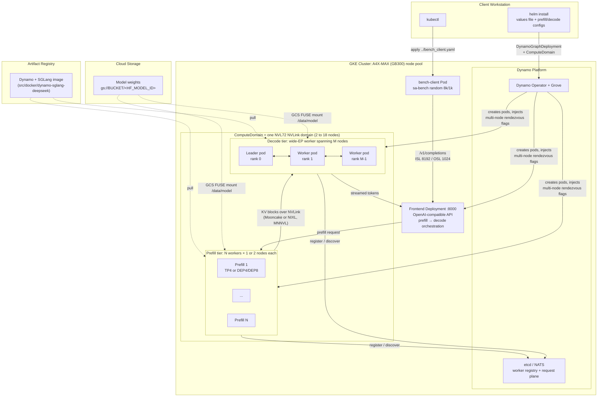
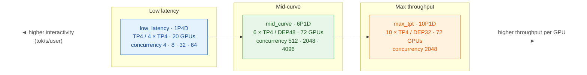
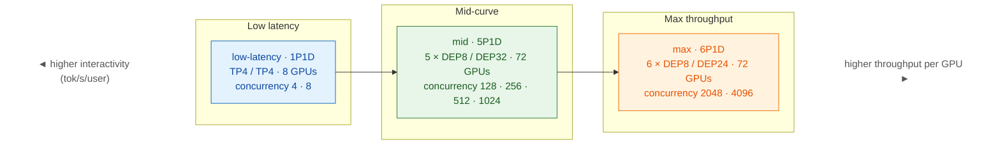
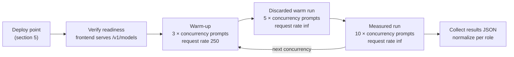

# DeepSeek-V4-Pro and DeepSeek-R1 Pareto-Sweep Recipes with NVIDIA Dynamo on A4X-MAX GKE

This recipe packages the operating points of the public [InferenceX](https://inferencex.semianalysis.com/inference) GB300 Pareto curves for **DeepSeek-V4-Pro (MXFP4 + EAGLE MTP)**, **DeepSeek-R1 (NVFP4)** and **DeepSeek-R1 (FP8)** as deployable [NVIDIA Dynamo](https://github.com/ai-dynamo/dynamo) + [SGLang](https://github.com/sgl-project/sglang) disaggregated deployments on [A4X-MAX (GB300 NVL72) GKE node pools](https://cloud.google.com/compute/docs/accelerator-optimized-machines#a4x-vms).

Every point on a Pareto curve is a tuple of **topology** (how many prefill and decode workers, how many nodes each spans), **serving flags** (parallelism, MoE backend, memory, CUDA graphs, speculative decoding) and **benchmark concurrency**. This recipe turns each tuple into one Helm values file plus a prefill and a decode serving configuration, so you can deploy any point on an A4X-MAX NVL72 domain and reproduce the measurement with the same benchmark client and methodology. It builds on the generic [A4X-MAX disaggregated Dynamo recipe](../README.md) and reuses its Helm chart, platform install and benchmark client.

> [!NOTE]
> This document describes **where each operating point sits on the Pareto curve** (low latency, mid-curve, max throughput) and how to deploy and measure it. It intentionally does not publish throughput or latency figures.

<a name="table-of-contents"></a>
## Table of Contents

* [1. Test Environment](#test-environment)
* [2. High-Level Architecture](#architecture)
* [3. Environment Setup (One-Time)](#environment-setup)
  * [3.1. Shared Setup from the Parent Recipe](#shared-setup)
  * [3.2. Stage Model Weights](#stage-weights)
  * [3.3. Configure the Dynamo Image](#configure-image)
* [4. Operating Points and Pareto Maps](#operating-points)
  * [4.1. How to Read the Tables](#how-to-read)
  * [4.2. DeepSeek-V4-Pro (MXFP4 + EAGLE MTP)](#points-dsv4)
  * [4.3. DeepSeek-R1 (NVFP4)](#points-dsr1-fp4)
  * [4.4. DeepSeek-R1 (FP8)](#points-dsr1-fp8)
* [5. Deploy an Operating Point](#deploy)
* [6. Benchmark an Operating Point](#benchmark)
* [7. Monitoring and Troubleshooting](#monitoring)
* [8. Cleanup](#cleanup)
* [9. Sources](#sources)

<a name="test-environment"></a>
## 1. Test Environment

[Back to Top](#table-of-contents)

This recipe has been tested with the following configuration:

* **GKE Cluster**:
    * A GPU node pool with [a4x-maxgpu-4g-metal](https://docs.cloud.google.com/compute/docs/gpus#gb300-gpus) machines (4 × GB300 per node) that belong to **one NVL72 NVLink domain**. Operating points need between 2 and 18 nodes (8 to 72 GPUs); the point tables below give the exact count.
    * [Workload Identity Federation for GKE](https://cloud.google.com/kubernetes-engine/docs/concepts/workload-identity) enabled
    * [Cloud Storage FUSE CSI driver for GKE](https://cloud.google.com/kubernetes-engine/docs/concepts/cloud-storage-fuse-csi-driver) enabled
    * NVIDIA Dynamo Platform (operator, Grove and KAI scheduler) installed as described in the [parent recipe](../README.md#install-platform)
* **Software stack used for the measurements** (the serving flags in this recipe were measured with these versions; see [3.3](#configure-image) for how to build matching images):

| Model | Weights | SGLang image | Dynamo | KV transfer | MoE / speculative decoding |
| :--- | :--- | :--- | :--- | :--- | :--- |
| DeepSeek-V4-Pro (MXFP4) | `deepseek-ai/DeepSeek-V4-Pro` | `lmsysorg/sglang:nightly-dev-20260601-373cadc9` | built from `ai-dynamo/dynamo@81d0555` | Mooncake over NVLink (MNNVL) | DeepGEMM mega-MoE (`megamoe`), EAGLE MTP on decode |
| DeepSeek-R1 (NVFP4) | `nvidia/DeepSeek-R1-0528-NVFP4-v2`, served as `deepseek-ai/DeepSeek-R1` | `lmsysorg/sglang:v0.5.8.post1-cu130-runtime` | `ai-dynamo==0.8.1` | NIXL over NVLink (MNNVL) | DeepEP low-latency wide-EP on decode, no speculative decoding |
| DeepSeek-R1 (FP8) | `deepseek-ai/DeepSeek-R1-0528`, served as `deepseek-ai/DeepSeek-R1` | `lmsysorg/sglang:v0.5.8.post1-cu130` | `ai-dynamo==0.8.0` | NIXL over NVLink (MNNVL) | DeepEP normal (prefill) / low-latency (decode) wide-EP, no speculative decoding |

All three stacks keep KV-cache transfer and MoE all-to-all traffic on the NVL72 fabric (`MC_FORCE_MNNVL=1`, `NCCL_MNNVL_ENABLE=1`, `UCX_TLS=cuda_copy,cuda_ipc,tcp`), so no RDMA NIC resource claims are requested.

<a name="architecture"></a>
## 2. High-Level Architecture

[Back to Top](#table-of-contents)

Every operating point is the same shape: a pool of **prefill workers** that each own a few GPUs, one or more **decode workers** that are usually a single wide expert-parallel (DEP) group spanning several nodes, and a set of **Dynamo frontends** that split each request into a prefill leg and a decode leg. KV blocks produced by prefill are pushed to the decode worker over NVLink. All worker pods are placed inside one `ComputeDomain` so that NVLink (MNNVL) connectivity spans nodes.



How a point maps onto Kubernetes objects:

| Recipe knob | Where it lives | What it controls |
| :--- | :--- | :--- |
| `dynamo.prefillWorker.replicas` / `nodeCount` | values file | Number of prefill workers and nodes per worker (TP4 or DEP4 workers use 1 node; DEP8 workers use 2 nodes) |
| `dynamo.decodeWorker.replicas` / `nodeCount` | values file | Number of decode workers and nodes per worker (a DEP8 group is 2 nodes, DEP16 is 4, DEP24 is 6, DEP32 is 8, DEP48 is 12) |
| `dynamo.computeDomain.numNodes` | values file | `prefill replicas × nodeCount + decode replicas × nodeCount`; all pods of a point share this NVLink domain |
| `*-prefill.yaml` / `*-decode.yaml` | `$REPO_ROOT/src/frameworks/a4xmax/dynamo-configs/` | SGLang serving flags for each role, taken flag-for-flag from the InferenceX / srt-slurm recipe of that point |
| worker `envs` | values file | Transport (MNNVL/UCX), DeepGEMM / DeepEP tuning and DeepSeek-V4 reasoning env vars from the same recipe |

<a name="environment-setup"></a>
## 3. Environment Setup (One-Time)

[Back to Top](#table-of-contents)

<a name="shared-setup"></a>
### 3.1. Shared Setup from the Parent Recipe

Complete sections [2.1 to 2.6 of the parent recipe](../README.md#environment-setup) first (clone the repository, configure variables, connect to the cluster, create secrets, install the Dynamo Platform, set up the GCS bucket). Then point `RECIPE_ROOT` at this directory:

```bash
export RECIPE_ROOT=$REPO_ROOT/inference/a4xmax/disaggregated-serving/dynamo/pareto-sweep
```

<a name="stage-weights"></a>
### 3.2. Stage Model Weights

Stage the checkpoint of the model you want to sweep into `gs://${GCS_BUCKET}/<HF_MODEL_ID>` so that the chart mounts it at `/data/model/<HF_MODEL_ID>`:

```bash
pip install -U "huggingface_hub[cli]"

# DeepSeek-V4-Pro (MXFP4)
hf download deepseek-ai/DeepSeek-V4-Pro --local-dir ./deepseek-ai/DeepSeek-V4-Pro
gcloud storage cp -r ./deepseek-ai gs://${GCS_BUCKET}/

# DeepSeek-R1 NVFP4 (about 413 GB)
hf download nvidia/DeepSeek-R1-0528-NVFP4-v2 --local-dir ./nvidia/DeepSeek-R1-0528-NVFP4-v2
gcloud storage cp -r ./nvidia gs://${GCS_BUCKET}/

# DeepSeek-R1 FP8 (about 689 GB)
hf download deepseek-ai/DeepSeek-R1-0528 --local-dir ./deepseek-ai/DeepSeek-R1-0528
gcloud storage cp -r ./deepseek-ai gs://${GCS_BUCKET}/
```

> [!TIP]
> The 72-GPU points load the checkpoint on 18 nodes at once. The chart enables the GCS FUSE file cache on local SSD, so the first start of a point is the slowest; later points on the same nodes start much faster.

<a name="configure-image"></a>
### 3.3. Configure the Dynamo Image

Two options:

1. **Current Dynamo runtime image (simplest).** Use the SGLang runtime release artifact as in the parent recipe. The serving flags in this recipe are plain SGLang / Dynamo arguments and work with the current runtime:

```bash
export DYNAMO_IMAGE="nvcr.io/nvidia/ai-dynamo/sglang-runtime:1.0.1-cuda13"
```

2. **Exact measured stack (for parity with InferenceX).** Build the image that reproduces the SGLang + Dynamo versions from the table in [section 1](#test-environment) and push it to Artifact Registry. Dockerfiles live in [`src/docker/dynamo-sglang-deepseek/`](../../../../../src/docker/dynamo-sglang-deepseek/):

```bash
export REGION=<YOUR_ARTIFACT_REGISTRY_REGION>
export AR_REPO=<YOUR_ARTIFACT_REGISTRY_REPO>
cd $REPO_ROOT/src/docker/dynamo-sglang-deepseek

# DeepSeek-R1 NVFP4 (SGLang v0.5.8.post1 + ai-dynamo 0.8.1)
docker buildx build --platform linux/arm64 \
  --build-arg BASE_IMAGE=lmsysorg/sglang:v0.5.8.post1-cu130-runtime --build-arg DYNAMO_VERSION=0.8.1 \
  -t ${REGION}-docker.pkg.dev/${PROJECT_ID}/${AR_REPO}/dynamo-sglang-dsr1:0.8.1 --push .

# DeepSeek-R1 FP8 (SGLang v0.5.8.post1 + ai-dynamo 0.8.0)
docker buildx build --platform linux/arm64 \
  --build-arg BASE_IMAGE=lmsysorg/sglang:v0.5.8.post1-cu130 --build-arg DYNAMO_VERSION=0.8.0 \
  -t ${REGION}-docker.pkg.dev/${PROJECT_ID}/${AR_REPO}/dynamo-sglang-dsr1:0.8.0 --push .

# DeepSeek-V4-Pro (SGLang nightly + Dynamo built from git)
docker buildx build --platform linux/arm64 -f Dockerfile.dsv4 \
  -t ${REGION}-docker.pkg.dev/${PROJECT_ID}/${AR_REPO}/dynamo-sglang-dsv4:81d0555 --push .

export DYNAMO_IMAGE="${REGION}-docker.pkg.dev/${PROJECT_ID}/${AR_REPO}/dynamo-sglang-dsv4:81d0555"
```

When you use option 2, also pass `--set dynamo.frontend.image=${DYNAMO_IMAGE}` at install time (shown in [section 5](#deploy)) so that the frontend runs the same Dynamo build as the workers.

<a name="operating-points"></a>
## 4. Operating Points and Pareto Maps

[Back to Top](#table-of-contents)

<a name="how-to-read"></a>
### 4.1. How to Read the Tables

Each Pareto curve plots **total token throughput per GPU** against **interactivity** (tokens per second per user, the inverse of time per output token). Moving along the curve from left to right trades interactivity for throughput:

* **Low latency**: small, TP-only or few-node topologies at very low concurrency. Highest interactivity, lowest throughput per GPU.
* **Mid-curve**: wide expert-parallel decode groups at moderate concurrency. Balanced.
* **Max throughput**: the largest prefill pools and the highest concurrency the decode group can hold. Highest throughput per GPU, lowest interactivity.

Column legend for the tables below:

| Column | Meaning |
| :--- | :--- |
| **Pareto position** | Where the point sits on the curve (see above) |
| **Prefill / Decode** | `workers × parallelism (nodes per worker)`. `TPn` is tensor parallel; `DEPn` is data-parallel attention + expert parallel over `n` GPUs |
| **Nodes / GPUs** | Size of the `ComputeDomain` the point needs |
| **Concurrency** | The benchmark concurrencies swept against this topology (one deployment, several measurements) |
| **Values file** | Helm values in this directory (topology + env) |
| **Serving configs** | Prefix of the `-prefill.yaml` / `-decode.yaml` pair in `$REPO_ROOT/src/frameworks/a4xmax/dynamo-configs/` |
| **GKE status** | Whether the point has been measured on A4X-MAX GKE with this recipe's flags |

<a name="points-dsv4"></a>
### 4.2. DeepSeek-V4-Pro (MXFP4 + EAGLE MTP)

Source: InferenceX `dsv4-fp4-gb300-dynamo-sglang-mtp`, srt-slurm `recipes/dsv4-pro/sglang/gb300-fp4/8k1k/disagg/`. All decode workers run EAGLE multi-token prediction; the mid-curve and max-throughput points also use DeepGEMM mega-MoE with data-parallel attention on both roles.

```mermaid
---
config:
  layout: dagre
---
flowchart LR
  classDef ll fill:#E3F2FD,stroke:#1565C0,color:#0D47A1
  classDef mid fill:#E8F5E9,stroke:#2E7D32,color:#1B5E20
  classDef max fill:#FFF3E0,stroke:#EF6C00,color:#E65100
  classDef axis fill:none,stroke:none,color:#555

  AX1["◄ higher interactivity (tok/s/user)"]:::axis
  AX2["higher throughput per GPU ►"]:::axis

  subgraph LL["Low latency"]
    direction TB
    p1["p1 · 1P1D<br/>TP4 / TP4 · 8 GPUs<br/>concurrency 1"]:::ll
    p2["p2 · 1P6D<br/>DEP4 / 6 × TP4 · 28 GPUs<br/>concurrency 8 · 32 · 64"]:::ll
  end
  subgraph MID["Mid-curve"]
    direction TB
    p3["p3 · 1P1D<br/>DEP4 / DEP8 · 12 GPUs<br/>concurrency 256"]:::mid
    p4["p4 · 1P1D<br/>DEP4 / DEP16 · 20 GPUs<br/>concurrency 256"]:::mid
    p5["p5 · 2P1D<br/>2 × DEP4 / DEP8 · 16 GPUs<br/>concurrency 512"]:::mid
    p6["p6 · 4P1D<br/>4 × DEP4 / DEP8 · 24 GPUs<br/>concurrency 1024"]:::mid
  end
  subgraph MAX["Max throughput"]
    direction TB
    p7["p7 · 6P1D<br/>6 × DEP4 / DEP8 · 32 GPUs<br/>concurrency 4096"]:::max
    p8["p8 · 8P1D<br/>8 × DEP4 / DEP8 · 40 GPUs<br/>concurrency 8192"]:::max
  end

  AX1 ~~~ LL
  p1 --> p2 --> p3 --> p4 --> p5 --> p6 --> p7 --> p8
  MAX ~~~ AX2
```



| Point | Pareto position | Prefill | Decode | Nodes / GPUs | Concurrency | Values file | Serving configs | GKE status |
| :--- | :--- | :--- | :--- | :--- | :--- | :--- | :--- | :--- |
| **p1** | Low latency | 1 × TP4 (1 node) | 1 × TP4 (1 node) | 2 / 8 | 1 | `dsv4_p1_low_latency.yaml` | `dsv4-p1-low-latency-1p1d-tp4-tp4` | Measured |
| **p2** | Low latency | 1 × DEP4 (1 node) | 6 × TP4 (1 node each) | 7 / 28 | 8, 32, 64 | `dsv4_p2_low_latency.yaml` | `dsv4-p2-low-latency-1p6d-dep4-tp4` | Measured |
| **p3** | Mid-curve | 1 × DEP4 (1 node) | 1 × DEP8 (2 nodes) | 3 / 12 | 256 | `dsv4_p3_mid_curve.yaml` | `dsv4-p3-mid-curve-1p1d-dep4-dep8` | Measured |
| **p4** | Mid-curve | 1 × DEP4 (1 node) | 1 × DEP16 (4 nodes) | 5 / 20 | 256 | `dsv4_p4_mid_curve.yaml` | `dsv4-p4-mid-curve-1p1d-dep4-dep16` | Measured |
| **p5** | Mid-curve | 2 × DEP4 (1 node each) | 1 × DEP8 (2 nodes) | 4 / 16 | 512 | `dsv4_p5_mid_curve.yaml` | `dsv4-p5-mid-curve-2p1d-dep4-dep8` | Measured |
| **p6** | Mid-curve | 4 × DEP4 (1 node each) | 1 × DEP8 (2 nodes) | 6 / 24 | 1024 | `dsv4_p6_mid_curve.yaml` | `dsv4-p6-mid-curve-4p1d-dep4-dep8` | Measured |
| **p7** | Max throughput | 6 × DEP4 (1 node each) | 1 × DEP8 (2 nodes) | 8 / 32 | 4096 | `dsv4_p7_max_throughput.yaml` | `dsv4-p7-max-throughput-6p1d-dep4-dep8` | Measured |
| **p8** | Max throughput (end of curve) | 8 × DEP4 (1 node each) | 1 × DEP8 (2 nodes) | 10 / 40 | 8192 | `dsv4_p8_max_throughput.yaml` | `dsv4-p8-max-throughput-8p1d-dep4-dep8` | Measured (latency-only rerun) |

What changes along the curve: the decode worker keeps the same DEP8 shape from p3 onward while the prefill pool grows from 1 to 8 workers; the decode side trades speculative depth for batch capacity (EAGLE steps 3 → 2 → 1, larger `max-running-requests` and CUDA-graph batch, shorter context window) as concurrency rises.

<a name="points-dsr1-fp4"></a>
### 4.3. DeepSeek-R1 (NVFP4)

Source: InferenceX `dsr1-fp4-gb300-dynamo-sglang`, srt-slurm `recipes/gb300-fp4/8k1k/{low_latency,mid_curve,max_tpt}.yaml`. Prefill workers are always single-node TP4; the mid-curve and max-throughput points use one wide DeepEP low-latency decode group that spans 12 or 8 nodes.



| Point | Pareto position | Prefill | Decode | Nodes / GPUs | Concurrency | Values file | Serving configs | GKE status |
| :--- | :--- | :--- | :--- | :--- | :--- | :--- | :--- | :--- |
| **low_latency** | Low latency | 1 × TP4 (1 node) | 4 × TP4 (1 node each) | 5 / 20 | 4, 8, 32, 64 | `dsr1_fp4_low_latency.yaml` | `dsr1-fp4-low-latency-1p4d-tp4-tp4` | Measured |
| **mid_curve** | Mid-curve | 6 × TP4 (1 node each) | 1 × DEP48 (12 nodes) | 18 / 72 | 512, 2048, 4096 | `dsr1_fp4_mid_curve.yaml` | `dsr1-fp4-mid-curve-6p1d-tp4-dep48` | Measured |
| **max_tpt** | Max throughput | 10 × TP4 (1 node each) | 1 × DEP32 (8 nodes) | 18 / 72 | 2048 | `dsr1_fp4_max_throughput.yaml` | `dsr1-fp4-max-throughput-10p1d-tp4-dep32` | Measured |

What changes along the curve: the whole NVL72 rack is used for both wide points, but the max-throughput point moves 4 nodes from decode to prefill (10 prefill / 8 decode nodes instead of 6 / 12) so that prefill keeps the decode group saturated at high concurrency.

<a name="points-dsr1-fp8"></a>
### 4.4. DeepSeek-R1 (FP8)

Source: InferenceX `dsr1-fp8-gb300-dynamo-sglang`, srt-slurm `recipes/gb300-fp8/8k1k/stp/{low-latency,mid,max}.yaml`. Unlike the NVFP4 curve, the wide points run **multi-node prefill workers** (DEP8 = 2 nodes per worker, DeepEP normal mode) in front of a DEP32 or DEP24 decode group.



| Point | Pareto position | Prefill | Decode | Nodes / GPUs | Concurrency | Values file | Serving configs | GKE status |
| :--- | :--- | :--- | :--- | :--- | :--- | :--- | :--- | :--- |
| **low-latency** | Low latency | 1 × TP4 (1 node) | 1 × TP4 (1 node) | 2 / 8 | 4, 8 | `dsr1_fp8_low_latency.yaml` | `dsr1-fp8-low-latency-1p1d-tp4-tp4` | Measured at concurrency 4 |
| **mid** | Mid-curve | 5 × DEP8 (2 nodes each) | 1 × DEP32 (8 nodes) | 18 / 72 | 128, 256, 512, 1024 | `dsr1_fp8_mid_curve.yaml` | `dsr1-fp8-mid-curve-5p1d-dep8-dep32` | Measured |
| **max** | Max throughput | 6 × DEP8 (2 nodes each) | 1 × DEP24 (6 nodes) | 18 / 72 | 2048, 4096 | `dsr1_fp8_max_throughput.yaml` | `dsr1-fp8-max-throughput-6p1d-dep8-dep24` | Configured from the InferenceX recipe; not yet measured on GKE |

> [!NOTE]
> The parent recipe's generic `values_wo_deepep.yaml` (1P1D) and `values_deepep.yaml` (10P8D) DeepSeek-R1 FP8 deployments use the same two topologies as the **low-latency** and **mid** points here but with the current Dynamo runtime's serving flags. Use this directory when you want the InferenceX point definitions verbatim.

<a name="deploy"></a>
## 5. Deploy an Operating Point

[Back to Top](#table-of-contents)

Pick a row from the tables in [section 4](#operating-points) and set the four variables below from its **Values file** and **Serving configs** columns. The example deploys DeepSeek-V4-Pro point **p3** (mid-curve, 3 nodes).

1. Set the point and model variables:

```bash
export POINT_VALUES="dsv4_p3_mid_curve.yaml"
export POINT_CONFIG="dsv4-p3-mid-curve-1p1d-dep4-dep8"
export HF_MODEL_ID="deepseek-ai/DeepSeek-V4-Pro"          # nvidia/DeepSeek-R1-0528-NVFP4-v2 or deepseek-ai/DeepSeek-R1-0528 for DeepSeek-R1
export RELEASE_NAME="$USER-dsv4-p3"
```

2. Install the Helm release:

```bash
cd $RECIPE_ROOT
helm install -f ${POINT_VALUES} \
  --set workload.model=${HF_MODEL_ID} \
  --set workload.image=${DYNAMO_IMAGE} \
  --set dynamo.frontend.image=${DYNAMO_IMAGE} \
  --set volumes.gcsfuse.bucketName=${GCS_BUCKET} \
  --set dynamo.namespace=${NAMESPACE} \
  --set dynamo.nodeSelector."cloud\.google\.com/gke-nodepool"=${NODE_POOL} \
  --set-file prefill_serving_config=$REPO_ROOT/src/frameworks/a4xmax/dynamo-configs/${POINT_CONFIG}-prefill.yaml \
  --set-file decode_serving_config=$REPO_ROOT/src/frameworks/a4xmax/dynamo-configs/${POINT_CONFIG}-decode.yaml \
  ${RELEASE_NAME} \
  $REPO_ROOT/src/helm-charts/a4xmax/inference-templates/dynamo-deployment
```

Drop the `--set dynamo.frontend.image=...` line if you use the stock `sglang-runtime` image from option 1 in [section 3.3](#configure-image); the values files already pin the matching `dynamo-frontend:1.0.1` image.

3. Wait for every pod of the point to become `Running` and `Ready`:

```bash
kubectl get pods -n ${NAMESPACE} -w
```

A multi-node decode group appears as one leader pod (`...-decode-0-decode-ldr-...`) plus `nodeCount - 1` worker pods; multi-node prefill workers (FP8 **mid** / **max**) appear the same way for each prefill replica. Model load for the 72-GPU points can take tens of minutes on a cold GCS FUSE cache.

> [!IMPORTANT]
> Deploy **one point at a time per NVL72 domain** and uninstall it before the next one. Each values file sizes its own `ComputeDomain` and the 72-GPU points need the whole domain.

<a name="benchmark"></a>
## 6. Benchmark an Operating Point

[Back to Top](#table-of-contents)

All points are measured with the InferenceX methodology: the vLLM-style `benchmark_serving.py` client ("sa-bench"), a **random dataset with 8192 input / 1024 output tokens** (`--random-range-ratio 0.8`, `--ignore-eos`), unlimited request rate, and the concurrencies listed for the point. Each concurrency is run three times against the standing deployment: a short warm-up, a longer discarded warm run, then the measured run.



Throughput is normalized per role: **input tokens/s ÷ prefill GPUs**, **output tokens/s ÷ decode GPUs**, and **total tokens/s ÷ all GPUs** of the point. Interactivity is `1000 / mean TPOT (ms)`.

1. Deploy the benchmark client from the parent recipe and wait for `--- SETUP COMPLETE. POD IS READY. ---`:

```bash
kubectl apply -f $RECIPE_ROOT/../bench_client.yaml -n ${NAMESPACE}
kubectl logs -f pod/bench-client -n ${NAMESPACE}
```

2. Set the frontend, model names and the concurrencies of the point (from the **Concurrency** column):

```bash
export FRONTEND_HOST="$(kubectl get svc -n ${NAMESPACE} -o name | grep ${RELEASE_NAME} | grep frontend | head -n1 | cut -d/ -f2)"
export SERVED_MODEL_NAME="deepseek-ai/DeepSeek-V4-Pro"   # deepseek-ai/DeepSeek-R1 for both DeepSeek-R1 variants
export TOKENIZER="${HF_MODEL_ID}"
export CONCURRENCIES="256"                               # e.g. "4 8 32 64" for a low-latency point
```

3. Run the sweep from the `bench-client` pod. DeepSeek-R1 uses the client bundled in the Dynamo repository checkout:

```bash
kubectl exec -it bench-client -n ${NAMESPACE} -- bash -c "
  cd /workspace/dynamo/examples/backends/sglang/slurm_jobs/scripts/vllm && mkdir -p /logs/results
  run_bench() {  # concurrency num_prompts request_rate save_flags
    python3 -u benchmark_serving.py \
      --model ${SERVED_MODEL_NAME} --tokenizer ${TOKENIZER} \
      --host ${FRONTEND_HOST} --port 8000 \
      --backend dynamo --endpoint /v1/completions \
      --disable-tqdm --dataset-name random \
      --num-prompts \$2 \
      --random-input-len 8192 --random-output-len 1024 --random-range-ratio 0.8 \
      --ignore-eos --request-rate \$3 \
      --percentile-metrics ttft,tpot,itl,e2el \
      --max-concurrency \$1 --trust-remote-code \$4
  }
  for C in ${CONCURRENCIES}; do
    run_bench \$C \$((C*3)) 250 ''
    run_bench \$C \$((C*5)) inf ''
    run_bench \$C \$((C*10)) inf \"--save-result --result-dir /logs/results --result-filename results_concurrency_\${C}.json\"
  done
"
```

DeepSeek-V4-Pro must be benchmarked through its chat template with the DeepSeek-V4 tokenizer wrapper that ships with the srt-slurm copy of sa-bench. Clone it once inside the pod and add the two extra flags:

```bash
kubectl exec -it bench-client -n ${NAMESPACE} -- bash -c "
  [ -d /workspace/srt-slurm ] || git clone --depth 1 https://github.com/NVIDIA/srt-slurm.git /workspace/srt-slurm
  cd /workspace/srt-slurm/src/srtctl/benchmarks/scripts/sa-bench && mkdir -p /logs/results
  run_bench() {
    python3 -u benchmark_serving.py \
      --model ${SERVED_MODEL_NAME} --tokenizer ${TOKENIZER} \
      --host ${FRONTEND_HOST} --port 8000 \
      --backend dynamo --endpoint /v1/completions \
      --disable-tqdm --dataset-name random \
      --num-prompts \$2 \
      --random-input-len 8192 --random-output-len 1024 --random-range-ratio 0.8 \
      --ignore-eos --request-rate \$3 \
      --percentile-metrics ttft,tpot,itl,e2el \
      --max-concurrency \$1 --trust-remote-code \
      --use-chat-template \
      --custom-tokenizer sa_bench_tokenizers.sglang_deepseek_v4.SGLangDeepseekV4Tokenizer \$4
  }
  for C in ${CONCURRENCIES}; do
    run_bench \$C \$((C*3)) 250 ''
    run_bench \$C \$((C*5)) inf ''
    run_bench \$C \$((C*10)) inf \"--save-result --result-dir /logs/results --result-filename results_concurrency_\${C}.json\"
  done
"
```

4. Copy the result files out of the pod when the sweep finishes:

```bash
kubectl cp ${NAMESPACE}/bench-client:/logs/results ./results-${RELEASE_NAME}
```

Each JSON file contains `total_token_throughput`, `output_throughput`, the TTFT / TPOT / ITL / E2E percentiles and the request count; divide the throughputs by the GPU counts in the point table to place the point on the curve.

<a name="monitoring"></a>
## 7. Monitoring and Troubleshooting

[Back to Top](#table-of-contents)

Find pod names and follow logs as in the [parent recipe](../README.md#monitoring):

```bash
kubectl get pods -n ${NAMESPACE} | grep ${RELEASE_NAME}
kubectl logs -f <prefill-or-decode-pod-name> -c main -n ${NAMESPACE}
```

Checks that matter for Pareto reproduction:

* **KV transfer is on NVLink.** Worker logs should show Mooncake / NIXL using `cuda_ipc` transports and `MC_FORCE_MNNVL=1`; if you see TCP fallbacks the pods are not in the same `ComputeDomain` or the node pool spans more than one NVL72 domain.
* **JIT kernels compile before you measure.** DeepGEMM and FlashInfer compile kernels on first use; the warm-up and discarded runs in [section 6](#benchmark) exist to push those compiles out of the measured window. If the measured run shows a TTFT tail far above the median, repeat the measured run.
* **Decode group does not form.** A multi-node decode worker waits for all `nodeCount` pods; a `Pending` worker pod usually means the node pool has fewer free nodes than `computeDomain.numNodes`.
* **Multi-node prefill (FP8 mid / max).** Each DEP8 prefill replica needs two nodes; five or six replicas plus the decode group need the whole 18-node domain.
* **Frontend readiness.** The frontend only reports healthy after at least one prefill and one decode worker have registered; `curl http://<frontend>:8000/v1/models` lists the served model name once routing is possible.
* **DeepEP timeouts** on the wide FP8 points: see the DeepEP note in the [parent recipe](../README.md#monitoring).

<a name="cleanup"></a>
## 8. Cleanup

[Back to Top](#table-of-contents)

Uninstall the point and the benchmark client:

```bash
helm uninstall ${RELEASE_NAME} -n ${NAMESPACE}
kubectl delete -f $RECIPE_ROOT/../bench_client.yaml -n ${NAMESPACE} --ignore-not-found=true
```

To remove the Dynamo platform, namespace and secrets, follow the [parent recipe's cleanup](../README.md#cleanup).

<a name="sources"></a>
## 9. Sources

[Back to Top](#table-of-contents)

* InferenceX GB300 Dynamo + SGLang configurations: [`SemiAnalysisAI/InferenceX`](https://github.com/SemiAnalysisAI/InferenceX) (`dsv4-fp4-gb300-dynamo-sglang-mtp`, `dsr1-fp4-gb300-dynamo-sglang`, `dsr1-fp8-gb300-dynamo-sglang`) and the public [dashboard](https://inferencex.semianalysis.com/inference).
* Per-point serving recipes: [`NVIDIA/srt-slurm`](https://github.com/NVIDIA/srt-slurm) (`recipes/dsv4-pro/sglang/gb300-fp4/8k1k/disagg/`, `recipes/gb300-fp4/8k1k/`, `recipes/gb300-fp8/8k1k/stp/`) including the `deepep_config.json` embedded in the FP8 configs.
* GKE sweep harness, manifests and methodology notes: [`alisachen-google/gcp-dynamo-cuj/dynamo-disagg-sweep`](https://github.com/alisachen-google/gcp-dynamo-cuj/tree/main/dynamo-disagg-sweep).
