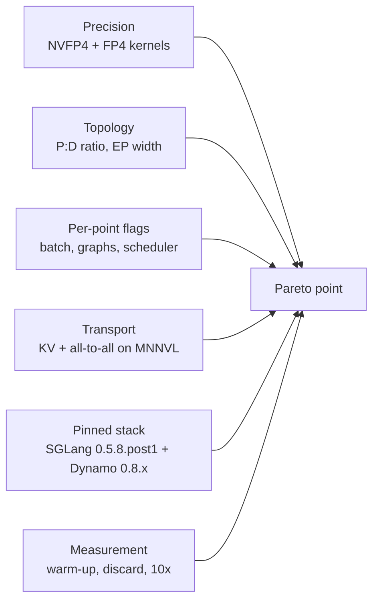

# DeepSeek-R1 on A4X Max: What the Pareto-Sweep Recipe Optimizes and Why

This report covers the DeepSeek-R1 part of the A4X Max Dynamo Pareto-sweep recipe merged into
[AI-Hypercomputer/gpu-recipes](https://github.com/AI-Hypercomputer/gpu-recipes) in
[`42dabd9`](https://github.com/AI-Hypercomputer/gpu-recipes/commit/42dabd93db14f37201f7993b9164f27ff732f16d)
(PR [#289](https://github.com/AI-Hypercomputer/gpu-recipes/pull/289)). It explains each
optimization in the new recipe, why it is there, and what it does for performance, using the
GKE measurements behind the recipe.

* Recipe: [`inference/a4xmax/disaggregated-serving/dynamo/pareto-sweep/`](https://github.com/AI-Hypercomputer/gpu-recipes/tree/main/inference/a4xmax/disaggregated-serving/dynamo/pareto-sweep)
* DeepSeek-R1 values files: [`deepseek-r1-nvfp4/`](https://github.com/AI-Hypercomputer/gpu-recipes/tree/main/inference/a4xmax/disaggregated-serving/dynamo/pareto-sweep/deepseek-r1-nvfp4) and [`deepseek-r1-fp8/`](https://github.com/AI-Hypercomputer/gpu-recipes/tree/main/inference/a4xmax/disaggregated-serving/dynamo/pareto-sweep/deepseek-r1-fp8)
* Serving configs: [`src/frameworks/a4xmax/dynamo-configs/dsr1-*`](https://github.com/AI-Hypercomputer/gpu-recipes/tree/main/src/frameworks/a4xmax/dynamo-configs)
* Image: [`src/docker/dynamo-sglang-deepseek/Dockerfile`](https://github.com/AI-Hypercomputer/gpu-recipes/blob/main/src/docker/dynamo-sglang-deepseek/Dockerfile)
* Full measurement reports: [DSR1 NVFP4](benchmark-report-dsr1-8k1k.md), [DSR1 FP8](benchmark-report-dsr1-fp8-8k1k.md), [tuning walkthrough](perf-tuning-walkthrough.md)

## Contents

1. [Summary](#1-summary)
2. [Where the recipe started](#2-where-the-recipe-started)
3. [Optimizations and rationale](#3-optimizations-and-rationale)
4. [Measured performance](#4-measured-performance)
5. [Open items](#5-open-items)
6. [Method and sources](#6-method-and-sources)

## 1. Summary

The new recipe turns DeepSeek-R1 on A4X Max from two fixed deployments into **six deployable
Pareto points**, three for NVFP4 and three for FP8. Each point is tuned for one place on the
throughput-versus-interactivity curve, and five of the six are measured on GKE. On the 8k-in /
1k-out workload, the measured points are **at parity with or ahead of the public InferenceX
GB300 reference**:

| What the recipe now delivers | Measured on GKE A4X Max |
| :--- | :--- |
| NVFP4 low-latency point (1P4D, 20 GPUs) | **+2.9 % to +7.8 %** output tok/s per decode GPU vs InferenceX at concurrency 4 to 64. TPOT is 6.25 ms at concurrency 4 (160 tok/s/user). |
| NVFP4 mid-curve point (6P1D, DEP48 decode, 72 GPUs) | −1.3 % / −2.7 % at concurrency 512 / 2048, and **+9.4 %** at 4096, where the reference falls past its knee. |
| FP8 low-latency point (1P1D, 8 GPUs) | **+1.4 %** throughput, TPOT 10.0 ms at concurrency 4. |
| FP8 mid-curve point (5P1D, DEP32 decode, 72 GPUs) | **−0.2 % to +3.4 %** throughput, with **15 % to 18 % lower median TTFT** at concurrency 128 to 1024. |
| Coverage | Interactivity from about 160 down to about 50 tok/s/user, and total throughput from about 250 up to about 6,500 tok/s per GPU, all from one recipe. |

The largest gains come from four changes:

* **NVFP4 weights with Blackwell FP4 kernels.** At the same concurrency, per-user decode speed
  is about 1.6× FP8's (TPOT 6.25 ms vs 10.0 ms at concurrency 4).
* **A topology for each Pareto point.** The prefill-to-decode GPU ratio and the decode
  expert-parallel width are matched to the concurrency each point serves.
* **KV transfer and MoE all-to-all on the NVL72 fabric (MNNVL).** No RDMA NICs are needed, and
  the transfer cost is negligible: under 0.5 % of NVLink bandwidth.
* **A fair, warm measurement method.** The recipe's warm-up and measurement protocol reports
  the server's real steady state. A short run understated the same server by 11 %.

## 2. Where the recipe started

The earlier A4X Max recipe ([parent README](https://github.com/AI-Hypercomputer/gpu-recipes/tree/main/inference/a4xmax/disaggregated-serving/dynamo))
shipped two DeepSeek-R1 FP8 deployments on the stock `sglang-runtime:1.0.1-cuda13` image: a
**1P1D TP4** (8 GPUs) and a **10P8D** (5 × DEP8 prefill + DEP32 decode, 72 GPUs). It carried
no NVFP4 option and no intermediate Pareto points. It routed KV transfer to the RDMA NICs
(`UCX_TLS=^tcp`, `disaggregation-ib-device`, `all-mrdma` claims), and it had no published
measurements. The new recipe keeps both topologies, as the FP8 **low-latency** and **mid**
points, and builds everything below on top of them.

## 3. Optimizations and rationale

### 3.1 Precision: NVFP4 checkpoint and Blackwell FP4 kernels

| Setting | Where | Rationale | Benefit |
| :--- | :--- | :--- | :--- |
| `nvidia/DeepSeek-R1-0528-NVFP4-v2` with `quantization: modelopt_fp4` | NVFP4 values + configs | GB300 runs FP4 tensor-core math at a multiple of the FP8 rate, and the weights shrink from about 689 GB to about 413 GB. Decode is memory-bandwidth-bound, so fewer weight bytes per token means faster tokens. | TPOT 6.25 ms vs FP8's 10.0 ms at concurrency 4: **about 1.6× interactivity**. It also frees HBM for KV cache. |
| `fp4-gemm-backend: flashinfer_trtllm` (low latency), `flashinfer_cutlass` (wide points) | serving configs | TRT-LLM kernels have the lowest launch latency at small batches, while CUTLASS grouped GEMMs win at the large per-rank batches of wide-EP decode. | Each point uses the fastest dense-GEMM path for its batch size. |
| `moe-runner-backend: flashinfer_cutedsl` (wide decode), `flashinfer_trtllm` (prefill, low latency) | serving configs | The CuTe-DSL MoE kernel consumes DeepEP low-latency's per-expert layout directly, so tokens are not re-packed. | Lower MoE time per decode step at DEP32/DEP48. |
| `SGLANG_MOE_NVFP4_DISPATCH=1` | NVFP4 decode env | DeepEP dispatch sends activations already quantized to FP4 instead of BF16. | Roughly 4× fewer all-to-all bytes per token on the decode critical path. |
| `SGLANG_NVFP4_CKPT_FP8_GEMM_IN_ATTN=1`, `SGLANG_PER_TOKEN_GROUP_QUANT_8BIT_V2=1` | NVFP4 decode env | Taken from the srt-slurm NVFP4 recipe: runs the checkpoint's attention-path GEMMs in FP8 and uses the v2 per-token-group 8-bit quantization kernel. | Faster attention-path GEMMs and activation quantization on decode. |
| `fp8-gemm-backend: flashinfer_trtllm` + `SGLANG_ENABLE_JIT_DEEPGEMM=true` | FP8 low latency | FP8 dense layers use TRT-LLM / DeepGEMM kernels tuned for Blackwell, not the generic path. | Lower per-layer GEMM latency at concurrency 4 to 8. |
| `kv-cache-dtype: fp8_e4m3`, `attention-backend: trtllm_mla` | all points | An FP8 KV cache halves KV memory and transfer bytes, and TRT-LLM MLA is the fastest MLA decode kernel on Blackwell. | More concurrent sequences per GPU and less KV traffic. |

### 3.2 Topology tuned per Pareto point

8k1k requests carry eight times more input than output, so prefill capacity sets how full
decode can stay. Each point sizes its prefill pool and decode expert-parallel width for its
target concurrency:

| Point | Topology | Why this shape | Effect |
| :--- | :--- | :--- | :--- |
| NVFP4 low latency | 1 × TP4 prefill → **4 × TP4 decode** (20 GPUs) | At concurrency ≤ 64, one TP4 prefill worker keeps up with four decoders, and small TP4 decode groups give the lowest TPOT. | Ahead of InferenceX at concurrency 4 to 64 (+2.9 % to +7.8 %), with TPOT 6.3 to 11.5 ms. |
| NVFP4 mid-curve | 6 × TP4 prefill → **1 × DEP48 decode** (72 GPUs) | Wide expert parallelism spreads the 256 routed experts across 48 GPUs, about 5 experts per GPU plus 32 redundant ones, so each GPU's MoE weights stay hot and the decode batch per rank grows. | 837 output tok/s per decode GPU at concurrency 4096, **+9.4 %** vs the reference. |
| NVFP4 max throughput | **10 × TP4 prefill** → 1 × DEP32 decode (72 GPUs) | Moves 4 nodes from decode to prefill so prefill keeps up with a full decode group at concurrency 2048. | Highest total throughput of the sweep: about 6,500 tok/s per GPU. |
| FP8 mid-curve | 5 × **DEP8 prefill (2 nodes each)** → 1 × DEP32 decode (72 GPUs) | FP8 prefill costs more compute per token than NVFP4, so each prefill worker spans 2 nodes (DEP8) and uses DeepEP normal mode with dynamic EPLB dispatch for large-batch MoE efficiency. | −0.2 % to +3.4 % vs the reference at concurrency 128 to 1024. |
| FP8 max throughput | 6 × DEP8 prefill → 1 × **DEP24** decode (72 GPUs) | More prefill and a narrower decode group for concurrency 2048 to 4096. | Configured from the reference; not yet measured on GKE. |

`dynamo.computeDomain.numNodes` sizes the IMEX ComputeDomain to exactly the point's nodes, so
every worker of a point shares one NVLink domain.

### 3.3 Per-point serving flags

**Low-latency points.** These are tuned for per-user speed:

| Flag | Value | Rationale |
| :--- | :--- | :--- |
| `scheduler-recv-interval` (FP8 decode) | `1` | Decode polls for new requests every step, so a request that has just been prefilled never waits up to 10 steps to join the batch. This cuts TTFT and inter-token jitter at low concurrency. |
| `stream-interval` | `10` (FP8), `50` (NVFP4) | Batches token streaming so the frontend does less per-token detokenize and HTTP work, without a visible effect on TPOT. |
| `cuda-graph-max-bs` / `max-running-requests` | `128` | Captures only the batch sizes this point actually uses. Startup is shorter and graph memory goes back to KV cache. |
| `chunked-prefill-size` / `max-prefill-tokens` (FP8 prefill) | `32768` | Up to four 8k prompts fit in one prefill pass without splitting. That means fewer, larger, more efficient prefill kernels. |
| `chunked-prefill-size: -1` (FP8 decode) | off | A decode worker never prefills, so chunking only adds scheduling overhead. |
| `enable-symm-mem` (NVFP4) | on | NCCL symmetric-memory all-reduce over NVLink lowers TP4 all-reduce latency on every layer. |
| `context-length` | `9300` (FP8), `9600` (NVFP4) | Just above the largest request (8192 + 1024), which bounds KV preallocation per sequence. |

**Wide-EP points (mid and max).** These are tuned for batch capacity:

| Flag / env | Value | Rationale |
| :--- | :--- | :--- |
| `moe-a2a-backend: deepep`; `deepep-mode: low_latency` (decode), `normal` (FP8 prefill) | — | Low-latency mode uses fixed-size, CUDA-graph-capturable dispatch buffers for decode, while normal mode gives the highest bandwidth for large prefill batches. |
| `cuda-graph-max-bs: 768` + explicit `cuda-graph-bs` list (FP8 decode) | 1 … 768 | Covers every per-rank batch size up to 768 with a captured graph: dense steps of 8 up to 384, then steps of 32. Decode steps never fall back to eager launch as the batch grows. |
| `SGLANG_DEEPEP_NUM_MAX_DISPATCH_TOKENS_PER_RANK` | `768` (FP8), `512` (NVFP4) | Sizes the DeepEP low-latency buffer to the largest captured batch, so graphs and buffers agree. |
| `max-running-requests` | `45000` (FP8 decode), `16384` (NVFP4 decode) | Admission is limited by KV memory, not by an artificial request cap. |
| `ep-num-redundant-experts: 32`, `eplb-algorithm: deepseek` | — | Replicates the hottest experts so no single EP rank becomes the step-time straggler. |
| `enable-dp-attention`, `enable-dp-lm-head`, `moe-dense-tp-size: 1` | — | Attention and the LM head run data-parallel, with no TP all-reduce across 32 to 48 ranks. Only the MoE layers communicate. |
| `num-reserved-decode-tokens: 112`, `disable-chunked-prefix-cache` (NVFP4) | — | Reserves KV headroom so running sequences are not preempted as they grow, and skips prefix-cache work that this workload, with radix cache off, never uses. |
| `mem-fraction-static` | 0.75 (FP8 prefill), 0.82 to 0.83 (decode) | Leaves room for DeepEP buffers and NCCL workspaces at 72-GPU scale, so wide groups start reliably. |
| `skip-tokenizer-init` | on | Wide workers receive token IDs from the frontend, so they skip tokenizer load and its per-request work. |

### 3.4 Transport: KV cache and all-to-all on MNNVL

| Setting | Rationale | Benefit |
| :--- | :--- | :--- |
| `UCX_TLS=cuda_copy,cuda_ipc,tcp` + `UCX_CUDA_IPC_ENABLE_MNNVL=y` | NIXL moves each KV block GPU to GPU over the NVL72 fabric with `cuda_ipc`, even across nodes. TCP carries control traffic only. | KV transfer at NVLink bandwidth. At concurrency 64, the KV stream is about 1.2 GB/s against a measured 723 to 730 GB/s fabric: under 0.5 % utilization, and about 1 to 3 ms inside requests that take 6 seconds or more. |
| `MC_FORCE_MNNVL=1`, `NCCL_MNNVL_ENABLE=1`, `NCCL_CUMEM_ENABLE=1` | Mooncake and NCCL also use the NVLink domain for collectives and DeepEP. | All MoE all-to-all traffic stays on NVLink. |
| `UCX_MEMTYPE_CACHE=n`, `UCX_MEMTYPE_REG_WHOLE=n` | Turns off UCX memory-type caching and whole-allocation registration for SGLang's pooled CUDA memory (adopted from the GKE reference values). | Consistent `cuda_ipc` transport selection for KV blocks. |
| No RDMA resource claim | The KV path no longer needs DraNet NICs or GID and rail tuning. | A simpler deployment. Our RDMA-KV A/B showed RDMA did not beat MNNVL on this workload ([walkthrough cases 2 and 8](perf-tuning-walkthrough.md)). |

### 3.5 Pinned software stack and image

* **Images:** `lmsysorg/sglang:v0.5.8.post1-cu130[-runtime]` plus `ai-dynamo` 0.8.1 (NVFP4) or
  0.8.0 (FP8). These are the exact versions the InferenceX GB300 reference pins, built with
  one [Dockerfile](https://github.com/AI-Hypercomputer/gpu-recipes/blob/main/src/docker/dynamo-sglang-deepseek/Dockerfile).
  The flags in section 3.3 are only valid and only tuned for this stack, and pinning makes
  the results comparable with the reference line for line.
* **Frontend:** the frontend uses the same image as the workers (`--set dynamo.frontend.image`),
  so the request-plane protocol versions match. Ten frontend replicas spread HTTP and
  tokenization load at concurrency in the thousands.
* **Startup:** `TORCH_DISTRIBUTED_DEFAULT_TIMEOUT=1800` and long startup probes let 72-GPU
  groups load weights and form DeepEP groups without restart loops.

### 3.6 Measurement protocol

Each concurrency runs three times: a warm-up of 3 × concurrency at request rate 250, a
discarded full-pressure pass of 5 × concurrency, then a measured run of 10 × concurrency.

* **Rationale:** throughput is tokens divided by wall time, and short runs overweight the
  ramp-up and drain edges. Kernel autotuning and DeepGEMM / FlashInfer JIT compiles also
  happen on first use.
* **Benefit:** on the same server, moving from a 4× to a 10× measured window raised measured
  throughput by **11.1 %** (272.9 → 303.1 output tok/s per decode GPU at NVFP4 concurrency 64)
  while TPOT stayed flat. The warm-up alone cut median TTFT by 26 %. Throughput is also
  normalized per role (input ÷ prefill GPUs, output ÷ decode GPUs), so points of different
  shapes can be placed on one curve.

## 4. Measured performance

Workload: random dataset, 8192 input / 1024 output tokens, `--random-range-ratio 0.8`,
`--ignore-eos`. GKE A4X Max (GB300 NVL72); the reference is InferenceX GB300 Dynamo + SGLang.
Throughput is output tok/s per decode GPU, and interactivity is 1000 / mean TPOT.

### 4.1 DeepSeek-R1 NVFP4

| Point | Conc | Output tok/s per decode GPU, GKE | InferenceX | Δ | TPOT mean (ms) | Interactivity (tok/s/user) |
| :--- | ---: | ---: | ---: | ---: | ---: | ---: |
| low latency (1P4D) | 4 | 36.5 | 34.4 | +6.1 % | 6.25 | 160 |
| low latency (1P4D) | 8 | 69.3 | 64.3 | +7.8 % | 6.62 | 151 |
| low latency (1P4D) | 32 | 197.8 | 192.1 | +2.9 % | 8.86 | 113 |
| low latency (1P4D) | 64 | 303.1 | 290.3 | +4.4 % | 11.47 | 87 |
| mid-curve (6P1D) | 512 | 436.4 | 442.2 | −1.3 % | 16.23 | 62 |
| mid-curve (6P1D) | 2048 | 816.5 | 838.8 | −2.7 % | 18.71 | 53 |
| mid-curve (6P1D) | 4096 | 837.4 | 765.5 | **+9.4 %** | 17.90 | 56 |
| max throughput (10P1D) | 2048 | 1,646.7 | 1,781.6 | −7.6 % | — | — |

TPOT at concurrency 4 and 8 comes from the first low-latency run. The concurrency 4 and 8
throughput comes from the NATS, 10× rerun.

### 4.2 DeepSeek-R1 FP8

| Point | Conc | Output tok/s per decode GPU, GKE | InferenceX | Δ | Median TTFT, GKE / InferenceX (ms) | Interactivity (tok/s/user) |
| :--- | ---: | ---: | ---: | ---: | :--- | ---: |
| low latency (1P1D) | 4 | 91.4 | 90.1 | +1.4 % | 450 / 429 | 99.7 |
| mid-curve (5P1D) | 128 | 233.0 | 227.8 | +2.3 % | 1,064 / 1,299 | 66.5 |
| mid-curve (5P1D) | 256 | 442.9 | 428.5 | +3.4 % | 1,383 / 1,646 | 64.4 |
| mid-curve (5P1D) | 512 | 789.4 | 773.3 | +2.1 % | 2,030 / 2,454 | 59.6 |
| mid-curve (5P1D) | 1024 | 1,352.7 | 1,354.7 | −0.2 % | 2,645 / 3,126 | 52.7 |

### 4.3 What the numbers show

* **NVFP4 is the interactivity lever.** At concurrency 4, NVFP4 decodes at 160 tok/s/user
  against FP8's 100: the FP4 weight-bandwidth win from section 3.1.
* **Wide EP is the throughput lever.** The NVFP4 mid-curve point holds about 837 output tok/s
  per decode GPU from concurrency 2048 to 4096, while the reference drops 9 %. The FP8 DEP32
  point scales throughput 5.8× from concurrency 128 to 1024 while losing only 21 % of
  interactivity.
* **MNNVL KV transfer costs nothing measurable.** Every point at or near parity uses NVLink
  KV transfer without RDMA NICs.
* **TTFT is better at mid-curve.** FP8 mid-curve median TTFT is 15 % to 18 % lower than the
  reference at every measured concurrency.

## 5. Open items

* **NVFP4 max throughput trails the reference by 7.6 %.** The cause is bursty dispatch across
  the 10-way prefill fan-out: about 30 of 64 requests per rank actually decode. This is
  independent of the request plane and still open
  ([walkthrough case 6](perf-tuning-walkthrough.md)).
* **The FP8 max-throughput point (6P1D DEP24) is not measured on GKE yet.** The FP8
  low-latency point at concurrency 8 also needs a rerun: its client failed with "Never
  received a valid chunk".
* **The FP8 mid-curve concurrency 128 run completed 1,250 of 1,280 requests.** Treat it as
  provisional until it is rerun.
* **The old recipe has no measurements.** The earlier 1P1D and 10P8D FP8 deployments were
  never benchmarked, so this report measures the new recipe against the InferenceX reference
  rather than against the old recipe. A same-topology A/B (old flags and image vs new) on one
  NVL72 domain would put a direct number on the stack and flag changes for FP8.

## 6. Method and sources

* **Benchmark client:** sa-bench, the vLLM-style `benchmark_serving.py` used by InferenceX and
  srt-slurm, run in-cluster against the Dynamo frontend. The commands are in
  [pareto-sweep section 6](https://github.com/AI-Hypercomputer/gpu-recipes/tree/main/inference/a4xmax/disaggregated-serving/dynamo/pareto-sweep#benchmark).
* **Reference results:** InferenceX `dsr1-fp4-gb300-dynamo-sglang` and
  `dsr1-fp8-gb300-dynamo-sglang` ([SemiAnalysisAI/InferenceX](https://github.com/SemiAnalysisAI/InferenceX),
  [dashboard](https://inferencex.semianalysis.com/inference)). The CSV copies are under
  [`dsr1-sweep/reference/`](../dsr1-sweep/reference/) and [`dsr1-fp8-sweep/reference/`](../dsr1-fp8-sweep/reference/).
* **Source recipes for the per-point flags:** [NVIDIA/srt-slurm](https://github.com/NVIDIA/srt-slurm)
  `recipes/gb300-fp4/8k1k/` and `recipes/gb300-fp8/8k1k/stp/`.
* **Raw results:** [`dsr1-sweep/results-summary/`](../dsr1-sweep/results-summary/) and
  [`dsr1-fp8-sweep/results-summary/`](../dsr1-fp8-sweep/results-summary/).
