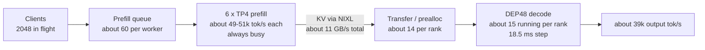

# DeepSeek-R1 NVFP4 Mid-Curve on A4X Max: Bottleneck and Kernel Analysis

This report looks at one operating point of the A4X Max Dynamo Pareto-sweep recipe: **DeepSeek-R1
NVFP4 mid-curve**, which runs 6 × TP4 prefill workers and 1 × DEP48 decode worker on 72 GB300
GPUs. It explains, from the serving config, the kernels SGLang selected and the server telemetry,
why this point is optimized enough as shipped, and where the remaining headroom is.

* Values file: [`dsr1_fp4_mid_curve.yaml`](https://github.com/AI-Hypercomputer/gpu-recipes/blob/main/inference/a4xmax/disaggregated-serving/dynamo/pareto-sweep/deepseek-r1-nvfp4/dsr1_fp4_mid_curve.yaml)
* Serving configs: [prefill](https://github.com/AI-Hypercomputer/gpu-recipes/blob/main/src/frameworks/a4xmax/dynamo-configs/dsr1-fp4-mid-curve-6p1d-tp4-dep48-prefill.yaml), [decode](https://github.com/AI-Hypercomputer/gpu-recipes/blob/main/src/frameworks/a4xmax/dynamo-configs/dsr1-fp4-mid-curve-6p1d-tp4-dep48-decode.yaml)
* Recipe-wide context: [DSR1 recipe optimization report](dsr1-a4xmax-recipe-optimization.md), [DSR1 NVFP4 benchmark report](benchmark-report-dsr1-8k1k.md), [tuning walkthrough](perf-tuning-walkthrough.md)
* Telemetry extraction: [`analyze-midcurve-telemetry.py`](../dsr1-sweep/analyze-midcurve-telemetry.py), output in [`m4-midcurve-telemetry.txt`](../dsr1-sweep/results-summary/m4-midcurve-telemetry.txt)

## Contents

1. [Verdict](#1-verdict)
2. [The point and its results](#2-the-point-and-its-results)
3. [Where the time goes: prefill is the binding stage](#3-where-the-time-goes-prefill-is-the-binding-stage)
4. [Decode: deliberately in the flat, latency-bound regime](#4-decode-deliberately-in-the-flat-latency-bound-regime)
5. [Prefill: compute-bound on the reference kernels](#5-prefill-compute-bound-on-the-reference-kernels)
6. [KV transfer](#6-kv-transfer)
7. [Levers already tested on this point](#7-levers-already-tested-on-this-point)
8. [Remaining headroom](#8-remaining-headroom)
9. [Method](#9-method)

## 1. Verdict

The mid-curve point is optimized enough as shipped, for four reasons. Each is backed by
measurements:

1. **The bottleneck is known: prefill is the binding stage.** At concurrency 2048 and 4096,
   every prefill worker always has a queue (100 % of batches). Doubling concurrency from 2048
   to 4096 adds only +2.6 % throughput. The system is pinned at about **43 requests/s**, which
   equals the 24 prefill GPUs' input rate divided by the mean prompt length.
2. **The binding stage runs at the reference's rate, using the reference's kernels.** Prefill
   delivers **13,050 input tok/s per GPU**, against InferenceX's 13,409 (−2.7 %) with the same
   SGLang build, the same FlashInfer / TRT-LLM / CUTLASS FP4 kernels and the same flags.
3. **Decode has headroom by design.** Each DEP48 rank holds about 15 running requests, at
   42 % KV usage, with zero retractions. Every step stays inside a captured CUDA graph, and
   step time stays nearly flat (16.8 → 18.5 ms) while the per-rank batch doubles. Decode is
   sized to keep TPOT low: this is the interactivity half of the mid-curve trade, not waste.
4. **Recipe-level levers are exhausted except one.** Env and frontend tuning, request-plane
   choice and higher concurrency do not raise the plateau. The one measured lever left is RDMA
   KV transfer (+1.5 % to +12.5 %). The rest of the headroom is kernel efficiency in prefill,
   at about 20–25 % of the dense tensor-core roofline. That is upstream kernel work, not flags.

## 2. The point and its results

| Role | Workers | Parallelism | GPUs | Key kernels (from the server args each worker logged) |
| :--- | :--- | :--- | ---: | :--- |
| Prefill | 6 × 1 node | TP4, EP1, CUDA graphs off | 24 | MoE `flashinfer_trtllm` (fused FP4 MoE), dense FP4 GEMM `flashinfer_cutlass`, attention `trtllm_mla`, FlashInfer all-reduce fusion on, attention GEMMs in FP8 (`SGLANG_NVFP4_CKPT_FP8_GEMM_IN_ATTN=1`) |
| Decode | 1 × 12 nodes | DEP48 (DP-attention 48, EP 48), 32 redundant experts | 48 | MoE `flashinfer_cutedsl` on DeepEP `low_latency`, FP4 GEMM `flashinfer_cutlass`, attention `trtllm_mla` (page size 64), FP4 dispatch (`SGLANG_MOE_NVFP4_DISPATCH=1`), CUDA graphs up to batch size 512 |

Workload: 8192 input / 1024 output tokens (`--random-range-ratio 0.8`, `--ignore-eos`). The
measured means are 7,372 input and 922 output tokens per request. Results below use the
recipe's path (TCP request plane, MNNVL KV transfer), with the 10× measured window:

| Concurrency | Output tok/s per decode GPU | InferenceX | Δ | Requests/s | TPOT mean | Median TTFT |
| ---: | ---: | ---: | ---: | ---: | ---: | ---: |
| 512 | 436.4 | 442.2 | −1.3 % | 22.7 | 16.2 ms | 0.79 s |
| 2048 | 816.5 | 838.8 | −2.7 % | 42.5 | 18.7 ms | 23.6 s |
| 4096 | 837.4 | 765.5 | **+9.4 %** | 43.6 | 17.9 ms | 67.7 s |

`stream-interval: 50` makes the client see tokens in chunks of 50, so the reported ITL
(about 0.9 s) is about 50 × TPOT. That is a reporting artifact, not a stall.

## 3. Where the time goes: prefill is the binding stage

Telemetry per benchmark window, averaged over the window. Decode is shown for 8 of the 48
ranks; prefill for 2 of the 6 workers. The ranks and workers sampled agree within 2 %.

| Concurrency | Prefill tok/s per GPU | Prefill batches with a non-empty queue | Decode running per rank | Decode in-transfer per rank | Decode step | Decode KV usage |
| ---: | ---: | ---: | ---: | ---: | ---: | ---: |
| 512 | 6,632–6,982 | 4–13 % | 7.3 | 3.0 | 16.8 ms | 0.15 |
| 2048 | 12,291–12,308 | **100 %** | 15.7 | 13.3 | 18.4 ms | 0.42 |
| 4096 | 12,587–12,630 | 49–100 % | 15.2 | 14.6 | 17.9 ms | 0.43 |

Three observations pin the bottleneck:

* **Prefill saturates first.** At concurrency 512, prefill idles most of the time, with a
  queue on only 4–13 % of batches. From concurrency 2048, it never drains. Its per-GPU rate
  stops at about 12.3–12.6k tok/s.
* **The plateau equals prefill capacity.** 24 GPUs × 13,050 tok/s ÷ 7,372 tokens per request
  = **42.5 requests/s**, which is exactly the measured c2048 rate. Going to concurrency 4096
  only moves the extra requests into the prefill queue: TTFT rises 2.9× while throughput rises
  2.6 %.
* **Decode occupancy is set by prefill, not by decode capacity.** By Little's law, requests
  decoding = arrival rate × decode time = 42.5 req/s × 922 tokens × 18.7 ms = 733. Divided by
  48 ranks, that is **15.3 per rank**, matching the 15.7 the logs show. The "in-transfer"
  requests (about 14 per rank) are decode slots preallocated for requests whose prefill has
  not finished yet. They are prefill backlog seen from the decode side.

## 4. Decode: deliberately in the flat, latency-bound regime

**Step time is nearly flat in the batch.** From 7.3 to 15.7 running requests per rank, the
step grows from 16.8 to 18.5 ms. That is about **0.2 ms per extra request**, on top of a
fixed cost of about 15.3 ms. Decode is latency-bound: extra batch is almost free.

**About 21 % of the step is HBM streaming:**

| Per-step data on one rank (c2048) | Size | Time at 8 TB/s HBM |
| :--- | ---: | ---: |
| Weights resident per rank (logged `mem usage=26.77 GB`; 6 local experts of 288, plus replicated attention, shared expert, dense layers and LM head) | about 25–27 GB | about 3.3 ms |
| KV read: 15.7 sequences × about 7.8k tokens × 61 layers × 576 B (FP8 MLA latent) | about 4.3 GB | about 0.5 ms |
| **Memory roofline** | **about 31 GB** | **about 3.9 ms of an 18.5 ms step** |

The remaining approximately 14.6 ms per step is fixed cost that does not scale with the batch:

* 58 MoE layers × DeepEP low-latency dispatch and combine across 48 ranks on 12 nodes;
* MLA decode attention and small-batch GEMMs at M ≈ 15 tokens per rank;
* routing, sampling and DP-attention synchronization.

We have not profiled this split, so treat the attribution as an estimate. The config already
removes every avoidable piece of it:

| Config choice | Effect on the step |
| :--- | :--- |
| CUDA graphs up to batch 512, `cuda_graph_always=True` in every logged interval | No kernel-launch overhead on any decode step |
| `moe-a2a-backend: deepep`, `deepep-mode: low_latency` | Fixed-size, graph-capturable all-to-all built for small decode batches |
| `SGLANG_MOE_NVFP4_DISPATCH=1` | Dispatch payload in FP4 rather than BF16, roughly 4× fewer bytes per token in each all-to-all |
| `moe-runner-backend: flashinfer_cutedsl` | Consumes DeepEP's per-expert layout directly, with no re-pack before the grouped GEMM |
| `enable-dp-attention`, `enable-dp-lm-head`, `moe-dense-tp-size: 1` | Attention, the dense layers and the LM head need no cross-rank all-reduce; only MoE communicates |
| `ep-num-redundant-experts: 32`, `eplb-algorithm: deepseek` | The hottest experts are replicated, so no rank becomes the step straggler |
| `num-reserved-decode-tokens: 112`, 524,288-token KV pool per rank | Zero retractions in every window, so running sequences are never preempted |

**Why not shrink decode to fill the batch?** With 2× the current per-rank batch (about 31),
the flat curve predicts a step of about 21.5 ms. That is about 1.7× the per-rank throughput,
with TPOT 15 % worse. Decode could absorb that, and the KV pool (42 % used) could hold it.
But prefill cannot feed it at 6 workers. Moving GPUs from decode to prefill is exactly what
the next Pareto point does: max throughput, 10 × TP4 prefill + DEP32 decode, reaches 1,647
(MNNVL) / 1,772 (RDMA KV) output tok/s per decode GPU. Mid-curve keeps the wide decode on
purpose, to hold about 53–56 tok/s per user while serving 43 requests/s.

## 5. Prefill: compute-bound on the reference kernels

Prefill batches are large: the median batch is 51k to 126k new tokens at c2048 / c4096, up
to the `chunked-prefill-size` of 131,072. GEMMs are in their efficient regime, so the stage is
compute-bound.

**Work per prompt token** (DeepSeek-V3/R1 architecture, 61 layers, mean prompt 7,372):

| Component | GFLOP per token | Precision in this config | Ideal time at dense peak |
| :--- | ---: | :--- | ---: |
| MoE: 8 routed + 1 shared expert × 58 layers | 46.0 | NVFP4 (`flashinfer_trtllm` fused MoE) | 3.1 µs at about 15 PFLOPS |
| MLA projections × 61 layers (about 187M params per layer) | 22.8 | FP8 (`SGLANG_NVFP4_CKPT_FP8_GEMM_IN_ATTN=1`) | 4.6 µs at about 5 PFLOPS |
| Causal attention core (mean context about 3.7k, 128 heads, QK 192 + V 128) | 18.4 | BF16 assumed (`trtllm_mla` prefill) | 7.4 µs at about 2.5 PFLOPS |
| First 3 dense FFN layers | 2.4 | BF16 assumed | 1.0 µs |
| **Total** | **89.6** | | **about 16 µs, or about 63k tok/s per GPU** |

The TP4 all-reduce of the 7,168-wide BF16 hidden state, 2 per layer × 61 layers, moves
about 1.75 MB per token. It is partly hidden by FlashInfer all-reduce + RMSNorm fusion (enabled in the log), and
worth up to about 3 µs per token if not overlapped. That puts a practical ceiling around
**50–60k tok/s per GPU**.

**Achieved:** 13,050 tok/s per GPU × 89.6 GFLOP = **about 1.17 PFLOPS per GPU, or about
20–25 % of that mixed-precision roofline.** Peaks are NVIDIA's approximate dense GB300 figures;
the conclusion holds within ±20 % of them.

Why we call this optimized enough for a recipe:

* **Same kernels, same rate as the reference.** The NVIDIA-tuned InferenceX run reaches
  13,409 tok/s per GPU (−2.7 %) on the same SGLang v0.5.8.post1 build and the same kernel
  selection. With RDMA KV, we reach 13,245 (−1.2 %).
* **The gap to roofline lives inside kernels, not in flags.** TP4 shards each expert's
  intermediate dimension to 512. A 51k-token batch puts about 1.6k tokens on each expert
  (51k × 8 ÷ 256). Attention at 7k context runs in BF16. Closing that needs kernel work
  upstream in FlashInfer, TRT-LLM and SGLang, or a different prefill parallelism, which is a
  different Pareto point.
* **CUDA graphs off is correct here.** At 51k to 126k tokens per batch, launch overhead is
  amortized. SGLang also disables CUDA graphs on PD prefill servers unless piecewise graphs
  are enabled (logged warning).

## 6. KV transfer

Each request carries 7,372 tokens × 61 layers × 576 B = **259 MB** of FP8 MLA KV. At 42.5
requests/s, that is **about 11 GB/s in total**, or about 1.8 GB/s per prefill worker. On the
NVL72 fabric (measured 723 to 730 GB/s per GPU), bandwidth is not a constraint for the
recipe's MNNVL path (`cuda_ipc`).

Even so, moving KV to GPUDirect RDMA measured faster on this point:

| Concurrency | Recipe (TCP + MNNVL) | NATS + MNNVL | NATS + RDMA KV | RDMA vs NATS + MNNVL | RDMA vs recipe |
| ---: | ---: | ---: | ---: | ---: | ---: |
| 512 | 436.4 | 469.0 | **491.1** | +4.7 % | **+12.5 %** |
| 2048 | 816.5 | 788.8 | **828.7** | +5.1 % | **+1.5 %** |
| 4096 | **837.4** | 748.0 | 830.8 | +11.1 % | −0.8 % |

All values are output tok/s per decode GPU. The RDMA runs carried transport evidence: 10,425
`rc_mlx5` operations and 0 `cuda_ipc` KV operations.

The gain is largest where the system is not prefill-bound (c512). It shrinks to +1.5 % on the
prefill plateau and disappears at c4096. That pattern fits a per-transfer latency or fabric
contention effect rather than bandwidth, but the mechanism is not isolated
([walkthrough case 8](perf-tuning-walkthrough.md),
[RDMA-KV report](benchmark-report-rdma-kv.md)).

## 7. Levers already tested on this point

| Lever (one-variable A/B unless noted) | Result | What it tells us |
| :--- | :--- | :--- |
| Measurement window 4× → 10× (low-latency point, same server) | +11.1 % throughput, TPOT flat | Applied everywhere; the numbers above are the honest steady state |
| Env tuning: frontends on GPU-node cores, `--reuse-http-connections`, 32-CPU client | Output −0.4 %, TPOT −5.3 % | Token delivery got faster, but completions stayed bound upstream (prefill) |
| NATS request plane instead of TCP | c512 +7.5 %, c2048 −3.4 %, c4096 −10.7 %; TPOT about 13.8 ms | NATS changes admission (longer queues, leaner decode batch), not capacity. It is not a universal win. |
| Concurrency 2048 → 4096 | +2.6 % throughput, TTFT 2.9× | The plateau is prefill capacity |
| RDMA KV transfer (NATS) | +1.5 % to +12.5 % vs the recipe | The one measured recipe-level gain left (section 6) |

## 8. Remaining headroom

| Source | Expected gain | Owner |
| :--- | :--- | :--- |
| RDMA KV transfer (mrdma claim with the ipvlan selector, `UCX_IB_GID_INDEX=5`, `UCX_NET_DEVICES=mlx5_0:1..mlx5_7:1`) | +12.5 % at c512, +1.5 % at c2048 (measured) | Recipe follow-up: an optional RDMA values variant |
| Prefill kernel efficiency (FP4 grouped GEMM at TP4 shard sizes, BF16 attention core, TP all-reduce) | Up to about 2× on prefill-bound concurrencies, at about 20–25 % of roofline today | Upstream FlashInfer / TRT-LLM / SGLang |
| Prefill-to-decode ratio | Higher throughput at lower interactivity | Already covered by the max-throughput Pareto point |
| Decode fixed per-step cost (about 14.6 ms of 18.5 ms) | Lower TPOT at the same throughput | Needs an nsys profile of DeepEP low-latency at 48 ranks; not yet done |

## 9. Method

* **Results:** sa-bench runs with 3× warm-up, a discarded 5× full-pressure pass and a 10×
  measured run. Each window is reconstructed from the result JSON (`date` minus `duration`).
  The raw JSONs are in [`dsr1-sweep/results-summary/`](../dsr1-sweep/results-summary/)
  (`m4-*`: recipe path; `m4n-*`: NATS; `m4r-*`: RDMA KV).
* **Telemetry:** SGLang `Decode batch` lines (every 1,000 steps per DP rank) and `Prefill batch`
  lines (every batch, TP0) from the run's worker logs, summarized per window by
  [`analyze-midcurve-telemetry.py`](../dsr1-sweep/analyze-midcurve-telemetry.py). Step time =
  running requests ÷ per-rank generation throughput.
* **Kernel selection:** read from the `server_args=ServerArgs(...)` line each worker logs at
  startup, not inferred from the YAML.
* **Roofline figures:** FLOP counts come from the DeepSeek-V3/R1 architecture (hidden size
  7,168, 61 layers, 58 MoE layers, 256 routed experts with intermediate size 2,048, MLA with
  KV-LoRA rank 512 and RoPE dim 64). Peak rates are approximate NVIDIA GB300 dense specs:
  FP4 about 15, FP8 about 5, BF16 about 2.5 PFLOPS, and 8 TB/s HBM. These are estimates to
  locate the bound, not profiler measurements.
* **Reference:** InferenceX `dsr1-fp4-gb300-dynamo-sglang`
  ([SemiAnalysisAI/InferenceX](https://github.com/SemiAnalysisAI/InferenceX)); per-point flags
  from [NVIDIA/srt-slurm](https://github.com/NVIDIA/srt-slurm) `recipes/gb300-fp4/8k1k/mid_curve.yaml`.
