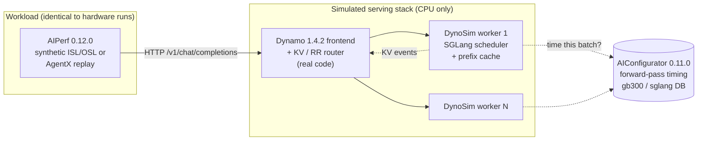
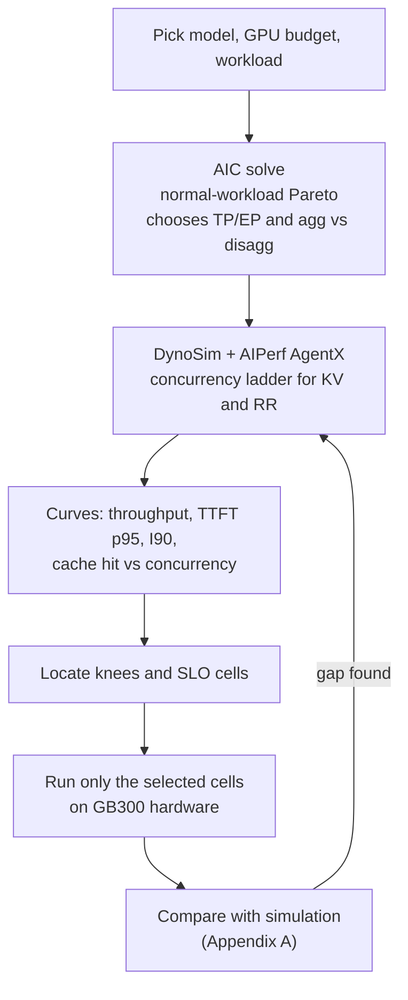
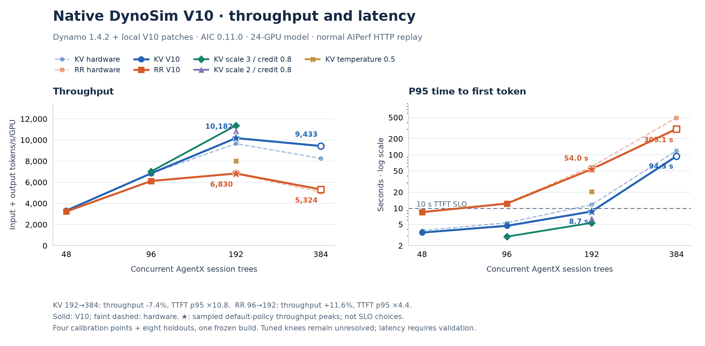
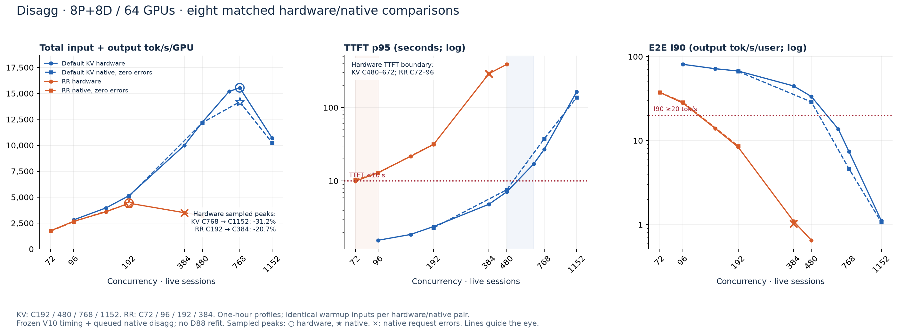
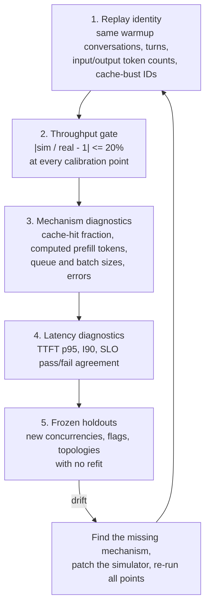

# Simulating Serving Curves with AIConfigurator + DynoSim

A practical guide to sweeping simulated operating points for **normal** (fixed input/output length) and **agentic** (multi-turn coding-agent) workloads before spending GPU hours, with **Nemotron-3-Ultra 550B NVFP4 (N3U) on GB300** as the worked example.

Everything here comes from the study in this directory. The deep-dive records are linked at each step:

* [`SIMULATION_GUIDE.md`](SIMULATION_GUIDE.md): the original Kimi-K2.5 pipeline (AIC solves and the historical custom simulator).
* [`nemotron-3-ultra-550b-nvfp4/`](nemotron-3-ultra-550b-nvfp4/README.md): the N3U study (design, simulation, hardware runs, calibration).
* [`SWEEP_METHODOLOGY.md`](SWEEP_METHODOLOGY.md): how knees and operating points are chosen.

## Contents

1. [The tools and what each one simulates](#1-the-tools-and-what-each-one-simulates)
2. [What curves and data the simulator produces](#2-what-curves-and-data-the-simulator-produces)
3. [Worked example: Nemotron-3-Ultra](#3-worked-example-nemotron-3-ultra)
4. [Appendix A: detecting drift and gaps between simulation and hardware](#appendix-a-detecting-drift-and-gaps-between-simulation-and-hardware)
5. [Appendix B: further reading](#appendix-b-further-reading)

---

## 1. The tools and what each one simulates

Four tools are involved. Each one answers a different question.

| Tool | What it is | Question it answers | What it does **not** do |
| :--- | :--- | :--- | :--- |
| **[AIConfigurator (AIC)](https://github.com/ai-dynamo/aiconfigurator)** | NVIDIA's analytical performance model. It uses kernel-level databases measured per GPU, backend and version (for example `gb300 / sglang / 0.5.14`). | *For a fixed ISL/OSL and GPU budget, which parallelism (TP/EP), agg vs disagg split and batch size gives the best throughput at each interactivity level?* It also gives per-forward-pass timing for prefill and decode. | It has no routing, no prefix cache and no multi-turn sessions. Every request is identical (one ISL, one OSL, optional fixed prefix). |
| **[Dynamo](https://github.com/ai-dynamo/dynamo) frontend + KV router** | The real Dynamo frontend and router (`round-robin` or `kv`), unmodified, running on a CPU host. | *Which worker gets each request?* The router uses the same cost function, overlap scores and flags as production. | It does not execute a model. |
| **DynoSim (Dynamo Mocker)** | Dynamo's [`mocker`](https://github.com/ai-dynamo/dynamo/tree/v1.4.2/lib/mocker) engine. It is a simulated worker with a real SGLang-style scheduler ([`scheduler/sglang`](https://github.com/ai-dynamo/dynamo/tree/v1.4.2/lib/mocker/src/scheduler/sglang)): waiting and running queues, chunked prefill, batch limits, a prefix cache and KV events. With the `aic-forward-pass` feature, each simulated forward pass asks AIC for its duration. | *Given the router's placements, how do queueing, batching, cache hits and prefill/decode interference turn into TTFT, ITL and throughput?* | It generates synthetic tokens, not real text. Its timing is only as good as AIC plus the calibration in [Appendix A](#appendix-a-detecting-drift-and-gaps-between-simulation-and-hardware). |
| **[AIPerf](https://github.com/ai-dynamo/aiperf)** | NVIDIA's benchmark client. It is the same binary and the same flags we use against real GB300 deployments. | *What does the workload look like?* It covers fixed-length synthetic traffic or the real [AgentX](https://github.com/ai-dynamo/aiperf/blob/v0.12.0/docs/tutorials/agentx-mvp.md) coding-agent replay: session trees, branches and joins, think time, warmup and recycling. | It does not model the server; it measures whatever endpoint it is pointed at. |

How they fit together:



The key idea: **only the GPU is simulated**. The client, the workload, the router and the scheduler logic are the same code that runs in production, so routing effects (cache hits, load balance, queueing) come out of the simulation instead of being assumed.

> [!NOTE]
> **Two simulators carry the "dynosim" name in this directory.** The `scripts/dynosim_*.py` files are an earlier custom Python serving model written for this study, not NVIDIA's DynoSim. Their results are historical. The [serving-model audit](nemotron-3-ultra-550b-nvfp4/reports/agentx-serving-model-audit.md) explains the difference. **All current N3U simulation results use the native Dynamo Mocker path above** (labelled "Native DynoSim V10/V11").

### Where AIC is used on its own

AIC also runs standalone, with no Mocker and no client. That is the fastest way to get **normal-workload curves** and to choose the engine shape (TP/EP and agg vs disagg) before any routing study. A solve takes minutes:

```bash
pip install aiconfigurator==0.11.0          # 0.10.0 does not support NemotronH
aiconfigurator cli support --model nvidia/NVIDIA-Nemotron-3-Ultra-550B-A55B-NVFP4 \
  --system gb300 --backend sglang            # stage 0: is this model/system/backend covered?

aiconfigurator cli default --model-path <local N3U config dir> --system gb300 \
  --backend sglang --total-gpus 24 --isl 96000 --osl 900 --prefix 92000 \
  --ttft 5000 --tpot 10 --max-seq-len 262144 --enable-chunked-prefill \
  --database-mode SILICON --save-dir aic-n3u-warm24
```

* `--database-mode SILICON` uses measured kernel tables. Use it for every solve.
* `--prefix 92000` models the warm case, where about 96% of each prompt is already cached. Drop it (and relax `--ttft`) for the cold case.
* `--ttft` and `--tpot` are solver targets for ranking, not SLO gates.

The full N3U solve set (warm and cold at 24 and 72 GPUs) is in [`sim-results/aic-nvfp4/`](nemotron-3-ultra-550b-nvfp4/sim-results/aic-nvfp4/).

---

## 2. What curves and data the simulator produces

### Normal workload (fixed ISL/OSL)

| Output | Source | How to read it |
| :--- | :--- | :--- |
| **Pareto frontier**: throughput per GPU against throughput per user | AIC `pareto.csv` and `pareto_frontier.png`, separately for agg and disagg | Each point is one engine configuration at one concurrency. Moving right means faster per-user generation (interactivity); moving up means more fleet throughput. AIC's `tokens/s` columns count **output** tokens. |
| **Best configurations** (top-N) | AIC `best_config_topn.csv` | Parallelism (`tp4pp1dp2etp4ep2`, ...), P:D worker split, batch size, TTFT and TPOT for each candidate. |
| **Launchable configs** | AIC `top*/k8s_deploy.yaml`, `run_*.sh` | A starting point for a real deployment of the chosen shape. |
| **Warm vs cold bracket** | Two solves (`--prefix` on and off) | Bounds what prefix reuse is worth before any routing is modeled. |

### Agentic workload (AgentX replay through native DynoSim)

AgentX is **closed loop**: concurrency `C` is the number of live agent sessions, and each session's next turn waits for the previous response plus its recorded think time. Latency therefore changes how much work arrives, so these curves must come from a full replay rather than a formula.

| Curve or metric | Per run (AIPerf export) | Why it matters |
| :--- | :--- | :--- |
| **Total tokens/s/GPU against session concurrency** | `total_token_throughput / GPUs` | Fleet capacity, including cached input tokens. The peak locates the throughput knee. |
| **TTFT p50/p95 against concurrency** | `time_to_first_token` | Where queueing starts. Re-prefill caused by a poor routing choice shows up here first. |
| **E2E-normalized interactivity (I90)** | Per-request output tokens per second | What each agent session experiences end to end. |
| **Prefix cache-hit rate** | Worker metrics and forward-pass counters | The mechanism behind the KV-vs-RR gap. |
| **KV vs RR at equal concurrency, and at a latency SLO** | Pairs of runs that differ only in router mode | The headline comparison: throughput at `TTFT p95 < 10 s` (and `I90 >= 20`) for each policy at its own best concurrency. |
| **Router-flag sweep** | Same point, different `DYN_ROUTER_*` settings | Screens tuning candidates (for example `--router-prefill-load-scale 3`) before hardware. |
| **Topology search** | Sweep of P:D splits at a fixed GPU count | Ranks disagg splits, for example 4:12, 8:8 and 12:4 on 64 GPUs. |



---

## 3. Worked example: Nemotron-3-Ultra

### 3.1 Why this model needs care

N3U is a hybrid model: 108 layers, of which 48 are Mamba-2, 48 are LatentMoE and **only 12 are full attention** ([design notes](nemotron-3-ultra-550b-nvfp4/DESIGN.md#0-model-facts-and-why-they-reshape-the-experiment)).

* The attention KV cache is small (about 6 KB/token), so cache capacity is rarely the limit.
* Each request also carries about 200 MB of **Mamba recurrent state**. A cached prefix is only reusable if it ends at a stored state checkpoint. This is the main reason a plain attention-only cache model mispredicts this model.

The serving setup being simulated matches the published recipes:

| | Aggregated | Disaggregated (D88) |
| :--- | :--- | :--- |
| GPUs | 24 (6 workers × TP4/EP4) | 64 (8 prefill + 8 decode, TP4/EP4) |
| Worker limits | max running 16, 16,384-token chunks | P: 8 running, D: 64 running |
| Software | Dynamo 1.4.2 + SGLang 0.5.16 (hardware); AIC 0.11.0 tables for SGLang 0.5.14 | same |
| Workload | AgentX, [`semianalysisai/cc-traces-weka-062126-256k`](https://huggingface.co/datasets/semianalysisai/cc-traces-weka-062126-256k), 393 roots, seed 42 | same |

### 3.2 Step 1: AIC normal-workload solve (engine shape)

The workload is encoded from the trace means (ISL 96,000, OSL 900) as warm and cold brackets at 24 and 72 GPUs. Results ([`sim-results/aic-nvfp4/`](nemotron-3-ultra-550b-nvfp4/sim-results/aic-nvfp4/)), best output tokens/s/GPU with at least 20 tokens/s/user:

| Bracket | Agg | Disagg | Frontier plot |
| :--- | :--- | :--- | :--- |
| Warm, 24 GPUs | **713** @ 36.5 tok/s/user | 558 @ 47.9 | [png](nemotron-3-ultra-550b-nvfp4/sim-results/aic-nvfp4/warm24/n3u-fp4_gb300_sglang_isl96000_osl900_ttft5000_tpot10_356262/pareto_frontier.png) |
| Warm, 72 GPUs | **713** @ 36.5 | 611 @ 21.3 | [png](nemotron-3-ultra-550b-nvfp4/sim-results/aic-nvfp4/warm72/n3u-fp4_gb300_sglang_isl96000_osl900_ttft5000_tpot10_73217/pareto_frontier.png) |
| Cold, 24 GPUs | **120** @ 20.2 | 110 @ 22.4 | [png](nemotron-3-ultra-550b-nvfp4/sim-results/aic-nvfp4/cold24/n3u-fp4_gb300_sglang_isl96000_osl900_ttft30000_tpot10_427557/pareto_frontier.png) |
| Cold, 72 GPUs | **120** @ 20.2 | 112 @ 35.5 | [png](nemotron-3-ultra-550b-nvfp4/sim-results/aic-nvfp4/cold72/n3u-fp4_gb300_sglang_isl96000_osl900_ttft30000_tpot10_375345/pareto_frontier.png) |

What this tells us:

* **Agg leads disagg** for this architecture, because prefill is cheap and transfers are light. That is why the agg 24-GPU study came first.
* **Prefix reuse is worth about 6× per GPU** (warm vs cold). This upper bound is what KV-aware routing tries to capture on real traffic.
* AIC's best warm agg point uses TP4 workers (`tp4pp1dp2etp4ep2`). The hardware recipe uses TP4/EP4 workers, and the agentic simulations below model that recipe shape.

### 3.3 Step 2: build the native DynoSim server

DynoSim is built from Dynamo v1.4.2 source with the study's patches applied in order. The patches are listed with their purpose in [Appendix A](#a3-how-each-gap-was-filled-n3u-calibration-history). They live in [`scripts/native_disagg_flags/patches/`](nemotron-3-ultra-550b-nvfp4/scripts/native_disagg_flags/patches/):

```bash
git clone https://github.com/ai-dynamo/dynamo.git && cd dynamo && git checkout v1.4.2
for p in cpu-build first-visible-token aic-prefill-calibration full-prefix-before-chunk \
         prefill-priority-hybrid-cache hybrid-checkpoint-publication hybrid-checkpoint-tracking \
         hybrid-checkpoint-lru prefill-prefix-admission prefill-remaining-budget \
         aic-decode-calibration; do
  git apply <study>/nemotron-3-ultra-550b-nvfp4/scripts/native_disagg_flags/patches/dynamo-1.4.2-$p.patch
done
# disagg (D88) additionally: dynamo-1.4.2-faithful-disaggregation.patch and
# sim-results/agentx_d88_matched_20260920/patches/d88-handoff-queue.patch
maturin build --release --features aic-forward-pass \
  --manifest-path lib/bindings/python/Cargo.toml --out /tmp/path1-wheels
pip install /tmp/path1-wheels/ai_dynamo_runtime-*.whl ai-dynamo==1.4.2 aiconfigurator-core==0.11.0
```

The full build and reproduction steps, including native-core SHA-256 values for each candidate, are in the [calibration report](nemotron-3-ultra-550b-nvfp4/reports/agentx-agg-kv-rr-data/native-v10/original-calibration-report.md#reproducing-the-native-builds-and-live-comparison).

The engine configuration shared by every N3U run:

* six TP4/EP4 workers, max running 16, 16,384-token chunks, 64-token cache pages
* **28,396,608 attention-KV tokens per worker** (measured on hardware)
* hybrid state: 769 Mamba state slots, 256-token checkpoint interval (model assumptions)

### 3.4 Step 3: sweep the agentic curves

The launch adapters run local NATS/etcd, the real Dynamo frontend, the patched Mocker workers and AIPerf, then write all outputs to a new directory per point:

* agg: [`scripts/native_v10_agg/run_path1_agentx.py`](nemotron-3-ultra-550b-nvfp4/scripts/native_v10_agg/README.md)
* disagg and topology: [`scripts/native_disagg_flags/`](nemotron-3-ultra-550b-nvfp4/scripts/native_disagg_flags/README.md) (`run_d88_matched.py`, `run_path1_topology.py`)

The client side is the same AIPerf command used on hardware:

```bash
aiperf profile --scenario inferencex-agentx-mvp \
  --url http://localhost:8000 --endpoint-type chat \
  --model nvidia/NVIDIA-Nemotron-3-Ultra-550B-A55B-NVFP4 \
  --tokenizer <tokenizer dir> --tokenizer-trust-remote-code \
  --public-dataset semianalysis_cc_traces_weka_062126_256k \
  --num-dataset-entries 393 --max-context-length 262144 \
  --concurrency ${C} --random-seed 42 \
  --trajectory-start-min-ratio 0.25 --trajectory-start-max-ratio 0.75 \
  --system-idle-gap-cap-seconds 10 --cache-bust first_turn_prefix \
  --benchmark-duration 3600 --benchmark-grace-period 60 --request-timeout-seconds 1200 \
  --streaming --use-server-token-count --extra-inputs ignore_eos:true \
  --artifact-dir runs/${POLICY}-c${C}
```

Sweep `C` over a geometric ladder for each router mode (for example 48, 96, 192 and 384 for agg; up to 1,152 for D88). Then add points around wherever a curve bends. The [reproduction guide](nemotron-3-ultra-550b-nvfp4/reports/agentx-replay-howto.md) has the dataset staging commands.

> [!TIP]
> Each point is a full one-hour profile plus warmup on CPU (the simulator runs in real time). Run several points in parallel with separate namespaces and ports.

### 3.5 What came out

**Agg, 24 GPUs** ([full report](nemotron-3-ultra-550b-nvfp4/reports/agentx-agg-kv-rr-report.md#31-native-dynosim-v10-current-completed-calibration-samples)). Native V10 against hardware for the default policies (total tokens/s/GPU, real / simulated):

| C | Default KV | RR |
| ---: | :--- | :--- |
| 48 | 3,334 / 3,321 | 3,250 / 3,232 |
| 96 | 6,844 / 6,842 | 6,137 / 6,121 |
| 192 | 9,655 / 10,182 | 6,802 / 6,830 |
| 384 | 8,257 / 9,433 | 5,076 / 5,324 |



The simulation reproduced:
* the KV-over-RR advantage
* both policies peaking near C192 and declining by C384
* the direction of the router-flag effects (scale 3 / credit 0.8 helps; temperature 0.5 hurts)

**Disagg D88, 64 GPUs** ([report section 4.2](nemotron-3-ultra-550b-nvfp4/reports/agentx-serving-perf-report.md#42-d88-native-forecasts-alongside-the-measured-kvrr-curves)). Eight holdout points with the agg coefficients frozen and no D88-specific fit: throughput is within 9% at every point, and KV's peak near C768 and RR's peak near C192 both match hardware.



**How to use these curves:**
1. Use the simulation to **screen**: rank policies, flags and splits, find the throughput knee, and pick which concurrencies deserve hardware time.
2. Then **confirm SLO boundaries on hardware**: TTFT tails are the least accurate output (Appendix A).

---

## Appendix A: detecting drift and gaps between simulation and hardware

### A.1 The checks, in order

A simulated point is only compared with hardware after the workload itself is proven identical. Otherwise a gap could come from a different workload rather than a different serving model.



1. **Replay identity** ([audit](nemotron-3-ultra-550b-nvfp4/reports/agentx-faithful-replay.md#parity-results)). The simulated run reuses the hardware run's benchmark ID, so the cache-bust text is identical. The audit then checks that the warmup conversations, turns and token counts match exactly (for example 185/185 at C192 and 349/349 at C384).
2. **Throughput gate.** Total tokens/s/GPU within ±20% at each calibration point (default KV and RR at C192 and C384). Errors keep their sign and are never averaged across points.
3. **Mechanism diagnostics.** Compare *why*, not just *how much*: newly computed prefill tokens against cached input tokens, cache-hit rate, and request errors and timeouts on the same source turns.
4. **Latency diagnostics.** TTFT p95 and I90 errors, and whether simulation and hardware agree on SLO pass/fail.
5. **Frozen holdouts.** New concurrencies, tuned flags and a new topology (D88) run with **no refit**. This is the real test of predictive power.

Drift means a holdout leaves the gate, or the error grows steadily with concurrency (for example, it is fine at low C and too optimistic past the knee). Either one points to a missing mechanism, not a wrong constant.

### A.2 What the gaps looked like for N3U

**The first simulator (custom Python model) drifted with load.** On D88 it under-predicted at low concurrency and over-predicted badly past the knee: measured/simulated was 1.32× at KV C96 and 0.43× at KV C1152 ([D88 record](nemotron-3-ultra-550b-nvfp4/AGENTX_D88_RESULTS.md#ii-simulated-curve-and-the-selected-points)). The [serving-model audit](nemotron-3-ultra-550b-nvfp4/reports/agentx-serving-model-audit.md) traced this to structure, not constants:
* decode speed was fixed when a request was admitted
* there was no chunked-prefill scheduler and no admission limits
* the cache was idealized

The fix was to replace it with the native Mocker scheduler.

**Native Mocker, before calibration**, over-predicted RR384 by **+64.8%** and missed TTFT by about half ([calibration table](nemotron-3-ultra-550b-nvfp4/reports/agentx-agg-kv-rr-data/native-v10/original-calibration-report.md#completed-end-to-end-comparisons)). The mechanism diagnostics found the causes one at a time:

| Symptom (diagnostic) | Root cause found | Effect |
| :--- | :--- | :--- |
| One-token warmup requests flagged invalid by AIPerf | The Mocker sampled token IDs that decode to whitespace, so the first response was empty | Changed the workload itself; fixed before any timing fit |
| Simulated reuse **12.4%** vs hardware cached input **56.2%** | The Mocker looked up the cached prefix only for the first 16K chunk | Long agent prompts lost most of their cache hits |
| KV over-predicted most at high C | No Mamba-state constraint: a prefix was reused even where no recurrent-state checkpoint existed | Hybrid cache was too generous |
| Decode too fast at every batch | AIC's analytical Mamba decode fallback omitted the recurrent-state read/write (about 100 MB per request per GPU) | Missing per-request decode cost |
| Disagg handoffs rejected under bursts | The handoff limit reused `max_num_seqs` | 2/32 burst completed; 32/32 after the fix |

### A.3 How each gap was filled (N3U calibration history)

Every fix is a **shared** model change or calibration term applied to all points. No per-point multipliers were used, and every attempt was kept on record.

| Candidate | Change (patch) | Agg RR384 throughput error |
| :--- | :--- | ---: |
| Baseline | Upstream Mocker + AIC + visible first token (`first-visible-token`) | +64.8% |
| v2 | Prefill timing fit to 93 isolated hardware warmups (`aic-prefill-calibration`): `prefill = 1.705 × AIC + 165.6 × b·q·(p + q/2) / 1e9` ms | — |
| v3 | Full-prefix lookup before chunking (`full-prefix-before-chunk`) | +55.5% |
| v4 | Prefill priority and a finite hybrid Mamba-state cache (`prefill-priority-hybrid-cache`) | stopped in warmup |
| v5 | Checkpoints published only when complete (`hybrid-checkpoint-publication`) | +4.5% |
| v6 | Branch and decode checkpoint tracking (`hybrid-checkpoint-tracking`) | +6.1% |
| v7 | Checkpoint recency / LRU (`hybrid-checkpoint-lru`) | +4.4% |
| v8–v9 | Prefix-lookup side effects, admission into the remaining prefill budget (`prefill-prefix-admission`, `prefill-remaining-budget`) | +5.2% |
| **v10** | Missing Mamba decode work (`aic-decode-calibration`): `decode = AIC + 0.288 + 0.0315 × ready_requests` ms | **+4.9%** |
| v11 (disagg) | Faithful P→D handoff + bounded handoff queue (`faithful-disaggregation`, `d88-handoff-queue`) | — |

Patch files: [`scripts/native_disagg_flags/patches/`](nemotron-3-ultra-550b-nvfp4/scripts/native_disagg_flags/patches/). Fit inputs: [prefill fit](nemotron-3-ultra-550b-nvfp4/reports/agentx-agg-kv-rr-data/native-v10/prefill_calibration_v2.json), [decode derivation](nemotron-3-ultra-550b-nvfp4/reports/agentx-agg-kv-rr-data/native-v10/decode_mamba_timing_candidate_v10.json).

### A.4 Where the gap stands now, and what is left

| Check | Result |
| :--- | :--- |
| Agg throughput, 4 calibration points | all within ±20% (worst +14.2%, KV384); mean absolute error 6.2% |
| Agg throughput, 8 frozen holdouts | 8/8 within ±20%; mean absolute error 1.7% |
| D88 throughput, 8 frozen holdouts | all within 9% |
| Agg TTFT p95 | mean absolute error 23.7% (calibration) and 9.4% (holdout); RR384 tail under-predicted by 38.4% |
| SLO pass/fail agreement | 1 of 12 agg pairs disagrees (tuned KV C192 passes in simulation, fails on hardware); D88 RR C72 sits on the TTFT boundary |

**Remaining gaps and how to treat them:**

* **TTFT tails** are under-predicted when the system is overloaded. Treat simulated SLO boundaries as estimates and confirm the boundary cell on hardware.
* **Hybrid-state settings** (769 slots, 256-token interval) are assumptions; the hardware Mamba pool was not captured. Capturing it is the next calibration input.
* **Version skew**: AIC's tables are for SGLang 0.5.14, while hardware runs 0.5.16. Re-check the gate when AIC publishes newer tables.
* **New hardware points become new holdouts.** Run them against the frozen build first. Only refit (and re-run every point) if a holdout leaves the gate.

---

## Appendix B: further reading

| Topic | Link |
| :--- | :--- |
| AIConfigurator (CLI, databases, SILICON mode) | <https://github.com/ai-dynamo/aiconfigurator> |
| Dynamo Mocker / DynoSim source | <https://github.com/ai-dynamo/dynamo/tree/v1.4.2/lib/mocker> |
| Dynamo KV router cost function and flags | <https://docs.nvidia.com/dynamo/knowledge-base/modular-components/router/routing-concepts> |
| Dynamo disaggregated routing | <https://docs.nvidia.com/dynamo/knowledge-base/modular-components/router/disaggregated-serving> |
| AIPerf AgentX scenario | <https://github.com/ai-dynamo/aiperf/blob/v0.12.0/docs/tutorials/agentx-mvp.md> |
| AIPerf Weka trace loader | <https://github.com/ai-dynamo/aiperf/blob/v0.12.0/docs/tutorials/weka-trace.md> |
| AgentX dataset | <https://huggingface.co/datasets/semianalysisai/cc-traces-weka-062126-256k> |
| Nemotron-3-Ultra NVFP4 checkpoint | <https://huggingface.co/nvidia/NVIDIA-Nemotron-3-Ultra-550B-A55B-NVFP4> |
| Mamba-2 (state-space models) | <https://arxiv.org/abs/2405.21060> |
| SGLang (RadixAttention prefix cache) | <https://github.com/sgl-project/sglang> |
| Knee and operating-point selection | [`SWEEP_METHODOLOGY.md`](SWEEP_METHODOLOGY.md) |
| Original Kimi-K2.5 simulation pipeline | [`SIMULATION_GUIDE.md`](SIMULATION_GUIDE.md) |
| N3U experiment design | [`nemotron-3-ultra-550b-nvfp4/DESIGN.md`](nemotron-3-ultra-550b-nvfp4/DESIGN.md) |
| N3U measured KV vs RR report | [`agentx-serving-perf-report.md`](nemotron-3-ultra-550b-nvfp4/reports/agentx-serving-perf-report.md) |
| N3U native calibration record (v2–v10) | [`original-calibration-report.md`](nemotron-3-ultra-550b-nvfp4/reports/agentx-agg-kv-rr-data/native-v10/original-calibration-report.md) |
| Replay audit and reproduction | [`agentx-faithful-replay.md`](nemotron-3-ultra-550b-nvfp4/reports/agentx-faithful-replay.md), [`agentx-replay-howto.md`](nemotron-3-ultra-550b-nvfp4/reports/agentx-replay-howto.md) |
