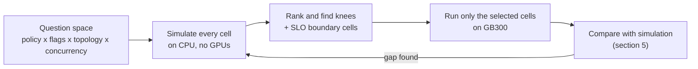
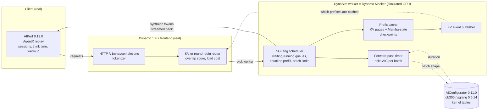
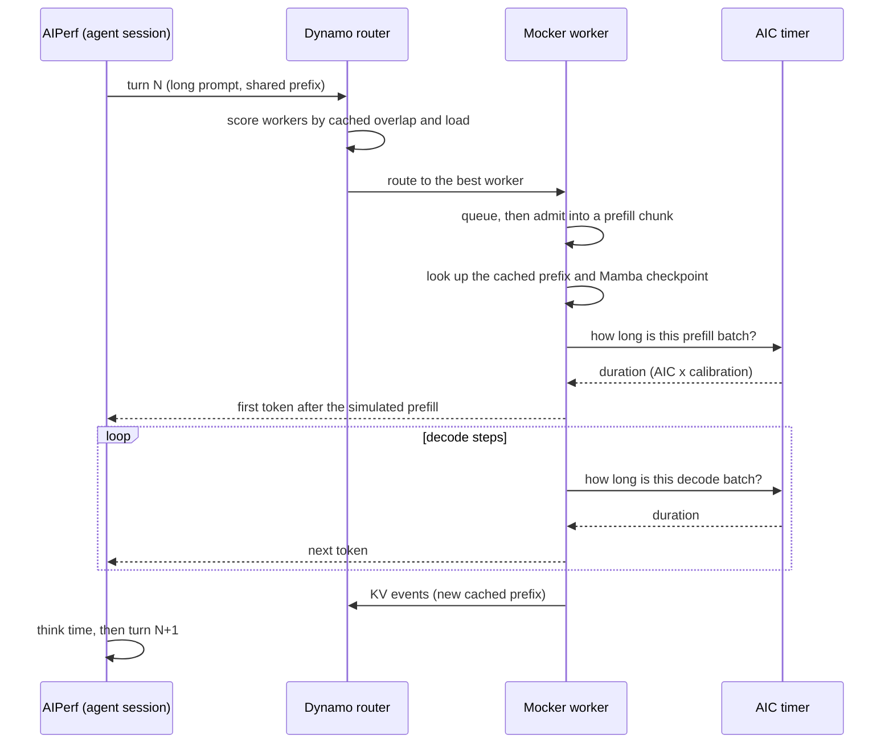
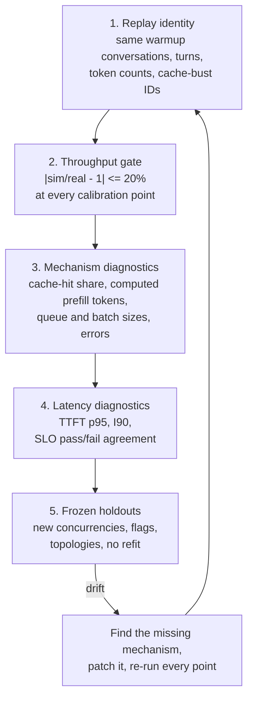

# Simulating Serving Curves with AIConfigurator + DynoSim

This guide explains how we simulate LLM serving on GB300 before spending GPU hours, using **Nemotron-3-Ultra 550B NVFP4 (N3U)** as the worked example throughout.

**Bottom line for N3U:** the simulator reproduced every measured throughput point within 15% on aggregated serving (24 GPUs) and within 9% on disaggregated D88 (64 GPUs). That makes it good enough to rank policies, flags and topologies and to find the throughput knee. TTFT near saturation can still be off by up to 39% in either direction, so SLO boundary points must be confirmed on hardware.

The numbers come from our N3U study: KV-aware vs round-robin runs on GB300 with the public [aggregated](https://github.com/AI-Hypercomputer/gpu-recipes/tree/main/inference/a4xmax/aggregated-serving/dynamo/nemotron3-ultra-kv-vs-rr) and [disaggregated](https://github.com/AI-Hypercomputer/gpu-recipes/tree/main/inference/a4xmax/disaggregated-serving/dynamo/nemotron3-ultra-kv-vs-rr) recipes, and the native simulation runs paired with them.

## Contents

1. [Why we need a simulator](#1-why-we-need-a-simulator)
2. [What each part of DynoSim does](#2-what-each-part-of-dynosim-does)
3. [How to use the simulator (N3U walk-through)](#3-how-to-use-the-simulator-n3u-walk-through)
4. [What the simulator delivers](#4-what-the-simulator-delivers)
5. [How to calibrate the simulation](#5-how-to-calibrate-the-simulation)
6. [References](#6-references)

---

## 1. Why we need a simulator

### 1.1 Hardware points are expensive

One agentic hardware point is a fresh deployment, a trajectory warmup, and a one-hour profile. The warmup alone grows with concurrency. On D88 (64 GB300 GPUs) the measured warmups were 815 s at RR C72 and 6,389 s at KV C1152.

| Point | GPUs | Warmup + 3,600 s profile | GPU-hours (lower bound, model load not counted) |
| :--- | ---: | ---: | ---: |
| D88 RR C72 | 64 | 815 + 3,600 s = 1.2 h | about 78 |
| D88 KV C480 | 64 | 3,334 + 3,600 s = 1.9 h | about 123 |
| D88 KV C1152 | 64 | 6,389 + 3,600 s = 2.8 h | about 178 |

Loading the 550B checkpoint from GCS FUSE adds more on every fresh install, and each KV vs RR pair needs two installs so that both arms start with a cold cache ([recipe section 4.3](https://github.com/AI-Hypercomputer/gpu-recipes/blob/main/inference/a4xmax/disaggregated-serving/dynamo/nemotron3-ultra-kv-vs-rr/README.md#deploy-rr)). The study's own proposed next agg flag batch is 8 profiles on 24 GPUs, 192 GPU-hours before any warmup or drain.

### 1.2 The question space is large

A routing study crosses several axes, and every cell is one of the points above:

* **Router policy:** round-robin vs KV-aware.
* **Router flags:** overlap credit, prefill load scale, temperature, credit decay. The C480 disagg flag plan alone lists 11 configurations plus 2 repeats.
* **Topology:** aggregated vs disaggregated, and the P:D split at a fixed GPU count (4:12, 8:8, 12:4 on 64 GPUs).
* **Concurrency ladder:** 4 to 8 points per curve to find the knee and the SLO boundary.

### 1.3 Agentic load has no closed-form answer

AgentX is closed loop: each agent session waits for its previous response, plus recorded think time, before it sends its next turn. Latency therefore changes how much work arrives. Cache hits depend on which worker the router picked for earlier turns, and queueing depends on both. A formula, or AIC on its own, cannot capture that feedback. A replay through the real router can.

### 1.4 What the simulator buys



* **Screening:** rank policies, flags and splits before any GPU time.
* **Point selection:** choose which concurrencies are worth a hardware run (the knee and the SLO boundary).
* **Explanation:** every simulated run records per-engine metrics and native forward-pass events (batch sizes, computed prefill tokens), which help explain a gap that hardware summaries only show in aggregate.

---

## 2. What each part of DynoSim does

### 2.1 The stack

Only the GPU is simulated. The client, the workload, the router and the scheduler logic are the same code that runs in production.



### 2.2 The parts and what each one does

| Part | Code | What it does in the simulation | What it does not do |
| :--- | :--- | :--- | :--- |
| AIPerf client | [AIPerf 0.12.0](https://github.com/ai-dynamo/aiperf), [AgentX scenario](https://github.com/ai-dynamo/aiperf/blob/v0.12.0/docs/tutorials/agentx-mvp.md) | Replays the 393-root [Weka 256K trace](https://huggingface.co/datasets/semianalysisai/cc-traces-weka-062126-256k) with the same flags as hardware: session trees, branches and joins, think time, trajectory warmup, recycling | Does not model the server |
| Frontend + router | [Dynamo 1.4.2](https://github.com/ai-dynamo/dynamo/tree/v1.4.2), [routing concepts](https://docs.nvidia.com/dynamo/knowledge-base/modular-components/router/routing-concepts) | The production router, unmodified. KV mode scores each worker by cached-prefix overlap against its prefill and decode load, using the same `--router-*` flags as the hardware recipe. | Runs no model |
| Mocker scheduler | [`lib/mocker/src/scheduler/sglang`](https://github.com/ai-dynamo/dynamo/tree/v1.4.2/lib/mocker/src/scheduler/sglang) | An SGLang-style scheduler: waiting and running queues, chunked prefill (16,384-token chunks), `max_num_seqs` (16 for agg), and the admission rules that create queueing | Executes no kernels |
| Prefix cache | Mocker cache + our hybrid-cache patches | 64-token KV pages sized to the measured 28,396,608 tokens per worker. For N3U it also models Mamba-state checkpoints: a prefix is reusable only where a checkpoint exists (769 slots, 256-token interval). | The Mamba settings are assumptions, not measured values |
| Forward-pass timer | `aic-forward-pass` build feature + our prefill and decode calibration patches | For each scheduled batch, asks AIC how long the prefill or decode step takes, then applies the shared calibration terms (section 5.4) | Timing is only as good as AIC plus calibration |
| KV event publisher | Mocker, ZMQ event plane | Tells the router which prefixes each worker holds, exactly as a real SGLang worker does, so KV routing sees realistic cache state | — |
| P to D handoff (disagg only) | `faithful-disaggregation`, `d88-handoff-queue` | Moves a finished prefill to a decode worker through a bounded queue (`handoff_max_sessions=4096`), with 64 GB/s per rank | Shared-link transfer contention is not modeled |
| AIConfigurator | [aiconfigurator](https://github.com/ai-dynamo/aiconfigurator) 0.11.0, `--database-mode SILICON` | Analytical model built from measured kernel tables (`gb300 / sglang / 0.5.14`). Used two ways: standalone for normal-workload Pareto solves, and as the Mocker's per-batch timer. | No routing, no prefix cache, no multi-turn sessions when standalone |

### 2.3 One request through the simulator



> [!NOTE]
> **Two simulators carry the "dynosim" name in this study.** `scripts/dynosim_*.py` (for example `dynosim_agentx_v5.py`) is an earlier custom Python model. Its results, including the 64-GPU topology sweep, are historical. All current results use the native Mocker path above.

---

## 3. How to use the simulator (N3U walk-through)

### 3.1 Prepare the environment

| Item | Version | Why |
| :--- | :--- | :--- |
| CPU host | No GPU needed | Runs everything. The simulator runs in real time, so a point takes as long as on hardware. |
| AIC CLI | `pip install aiconfigurator==0.11.0` | Standalone solves. 0.10.0 does not support NemotronH. |
| Simulator environment | `ai-dynamo==1.4.2`, the patched `ai_dynamo_runtime` wheel, `aiconfigurator-core==0.11.0` | Frontend, router, Mocker, and the AIC library the Mocker calls |
| Client environment | `aiperf==0.12.0`, kept separate from the simulator | Same client as hardware |
| NATS and etcd | Running locally before launch | Request plane and discovery. The launch scripts expect them already up (`--nats`, `--etcd`). |
| Dataset and tokenizer | [Weka 256K trace](https://huggingface.co/datasets/semianalysisai/cc-traces-weka-062126-256k), [N3U tokenizer](https://huggingface.co/nvidia/NVIDIA-Nemotron-3-Ultra-550B-A55B-NVFP4) | Loaded by AIPerf ([Weka trace loader](https://github.com/ai-dynamo/aiperf/blob/v0.12.0/docs/tutorials/weka-trace.md)) |

### 3.2 Step 1: solve the normal workload with AIC

Use AIC first to choose the engine shape. The N3U workload is encoded from the trace means (ISL 96,000, OSL 900), as a warm bracket (`--prefix 92000`, about 96% cached) and a cold one:

```bash
aiconfigurator cli support --model nvidia/NVIDIA-Nemotron-3-Ultra-550B-A55B-NVFP4 \
  --system gb300 --backend sglang                 # is this model/system/backend covered?

aiconfigurator cli default --model-path <local N3U config dir> --system gb300 \
  --backend sglang --total-gpus 24 --isl 96000 --osl 900 --prefix 92000 \
  --ttft 5000 --tpot 10 --max-seq-len 262144 --enable-chunked-prefill \
  --database-mode SILICON --save-dir aic-n3u-warm24
```

* `--database-mode SILICON` uses measured kernel tables. Use it for every solve.
* `--ttft` and `--tpot` rank candidates; they are not SLO gates.
* Repeat with `--total-gpus 72` and without `--prefix` (relax `--ttft`) for the other brackets.

[Section 4.1](#41-normal-workload-curves-from-aic) reads the N3U results.

### 3.3 Step 2: build the native DynoSim worker

Build Dynamo v1.4.2 with the study's patches, applied in this order. [Section 5.4](#54-how-each-gap-was-filled) says what each one fixes.

```bash
git clone https://github.com/ai-dynamo/dynamo.git && cd dynamo && git checkout v1.4.2
P=<repo>/kv-cache-aware-bench/nemotron-3-ultra-550b-nvfp4/scripts/native_disagg_flags/patches
for p in cpu-build first-visible-token aic-prefill-calibration full-prefix-before-chunk \
         prefill-priority-hybrid-cache hybrid-checkpoint-publication hybrid-checkpoint-tracking \
         hybrid-checkpoint-lru prefill-prefix-admission prefill-remaining-budget \
         aic-decode-calibration; do
  git apply $P/dynamo-1.4.2-$p.patch
done
# Disaggregated (D88) only:
git apply $P/dynamo-1.4.2-faithful-disaggregation.patch
git apply <repo>/kv-cache-aware-bench/nemotron-3-ultra-550b-nvfp4/sim-results/agentx_d88_matched_20260920/patches/d88-handoff-queue.patch

maturin build --release --features aic-forward-pass \
  --manifest-path lib/bindings/python/Cargo.toml --out /tmp/path1-wheels
pip install /tmp/path1-wheels/ai_dynamo_runtime-*.whl ai-dynamo==1.4.2 aiconfigurator-core==0.11.0
```

Check the build identity before trusting a result. The frozen V10 agg build has native-core SHA-256 `5e298de4...5bedd0d02`, and every run records its own.

### 3.4 Step 3: describe the engine

The worker reads one engine JSON that mirrors the hardware recipe. The N3U agg file preserved with each run, for example `agg-kv-c192-calibrated-v10/engine.json`, sets:

```json
{
  "engine_type": "sglang", "worker_type": "aggregated",
  "num_gpu_blocks": 443697, "block_size": 64,
  "max_num_seqs": 16, "max_num_batched_tokens": 16384,
  "enable_prefix_caching": true, "enable_chunked_prefill": true,
  "speedup_ratio": 1.0, "decode_speedup_ratio": 1.0,
  "aic_system": "gb300", "aic_backend": "sglang", "aic_backend_version": "0.5.14",
  "aic_tp_size": 4, "aic_moe_ep_size": 4, "aic_moe_dtype": "nvfp4",
  "sglang": {"page_size": 64, "chunked_prefill_size": 16384,
             "mamba_state_capacity": 769, "mamba_track_interval": 256},
  "aic_calibration": {"prefill_scale": 1.705, "prefill_attention_ms_per_billion_pairs": 165.57,
                      "decode_fixed_ms": 0.288, "decode_ms_per_request": 0.0315}
}
```

* `num_gpu_blocks` x `block_size` = 28,396,608 KV tokens, the value measured on hardware.
* `max_num_seqs` and `max_num_batched_tokens` match the serving config (`max-running-requests 16`, `chunked-prefill-size 16384`).
* `aic_calibration` holds the shared calibration terms from section 5. Never change them per point.

### 3.5 Step 4: run one point

`scripts/native_v10_agg/run_path1_agentx.py` starts the frontend, six Mocker workers and the AIPerf client. It reads the matching hardware run's AIPerf summary and records, so the replay reuses the same benchmark ID and warmup.

```bash
python3 scripts/native_v10_agg/run_path1_agentx.py \
  --hardware-summary <hardware run>/profile summary JSON \
  --hardware-records <hardware run>/per-request records \
  --engine-config reports/agentx-agg-kv-rr-data/native-v10/agg-kv-c192-calibrated-v10/engine.json \
  --router kv \
  --router-args-file <JSON list of the hardware recipe's router flags> \
  --workers 6 --gpus 24 \
  --namespace n3u-sim-kv-c192 --http-port 18000 --metrics-port 18090 \
  --run-dir runs/kv-c192
```

* The default router args for `kv` are `--router-temperature 0.0 --router-queue-policy fcfs`. For a tuned arm, pass the exact flags from the hardware values file, for example the [agg KV recipe](https://github.com/AI-Hypercomputer/gpu-recipes/blob/main/inference/a4xmax/aggregated-serving/dynamo/nemotron3-ultra-kv-vs-rr/nemotron3_ultra_agg_kv.yaml) (prefill load scale 3, overlap credit 0.8).
* The client side is the same AIPerf command as hardware ([recipe section 5](https://github.com/AI-Hypercomputer/gpu-recipes/blob/main/inference/a4xmax/aggregated-serving/dynamo/nemotron3-ultra-kv-vs-rr/README.md#ab-benchmark)): `--scenario inferencex-agentx-mvp`, `--random-seed 42`, 393 roots, a 3,600 s profile.
* Disaggregated and topology points use `run_d88_matched.py` and `run_path1_topology.py`. The `controller.py` queues many points under memory and parallelism limits.

### 3.6 Step 5: sweep and collect

1. Sweep `C` over a geometric ladder for each router mode: 48, 96, 192, 384 for agg; 72 to 1,152 for D88.
2. Add points where a curve bends, such as the knee or a TTFT crossing.
3. Run points in parallel, each with its own `--namespace` and ports.
4. Collect and check them with `collect_agg_v10_holdouts.py`. It verifies the frozen build, engine, router args and warmup identity before keeping a point. Metric parsing is covered by `test_metrics.py`.
5. Pick the knees and SLO boundary cells, then send only those cells to hardware.

Each run directory keeps `engine.json`, `provenance.json`, `server-environment.json`, `comparison.json` and `simulation_summary.json`.

---

## 4. What the simulator delivers

### 4.1 Normal-workload curves from AIC

AIC writes a Pareto frontier (`pareto.csv`, `pareto_frontier.png`), the top configurations (`best_config_topn.csv`) and launchable starting configs (`top*/k8s_deploy.yaml`), for agg and disagg separately. For N3U, the best output tokens/s/GPU with at least 20 tokens/s/user:

| Bracket | Agg | Disagg |
| :--- | :--- | :--- |
| Warm, 24 GPUs | **713** @ 36.5 tok/s/user | 558 @ 47.9 |
| Warm, 72 GPUs | **713** @ 36.5 | 611 @ 21.3 |
| Cold, 24 GPUs | **120** @ 20.2 | 110 @ 22.4 |
| Cold, 72 GPUs | **120** @ 20.2 | 112 @ 35.5 |

What it told us:

* **Agg leads disagg** for N3U. Prefill is cheap (only 12 of 108 layers are full attention) and KV transfers are light, so the 24-GPU agg study came first.
* **Prefix reuse is worth about 6x per GPU** (713 warm vs 120 cold). That is the upper bound KV-aware routing tries to capture.

### 4.2 Agentic curves from DynoSim

| Output | Source per run | What it answers |
| :--- | :--- | :--- |
| Total tokens/s/GPU vs concurrency | AIPerf `total_token_throughput` / GPUs | Fleet capacity and the throughput knee |
| TTFT p50/p95 vs concurrency | AIPerf `time_to_first_token` | Where queueing starts |
| E2E interactivity I90 | Per-request output tokens/s | What each agent session experiences |
| Per-engine metrics and forward-pass events | Mocker metrics endpoint and native event logs | Batch sizes and computed prefill tokens behind each curve |
| KV vs RR at equal C and at an SLO | Paired runs differing only in router mode | The headline comparison at TTFT p95 < 10 s and I90 >= 20 |
| Router-flag effects | Same point, different `--router-*` flags | Which tuning candidates deserve hardware time |
| Topology ranking | P:D splits at a fixed GPU count | Which disagg split to deploy |

### 4.3 N3U results against hardware

**Aggregated, 24 GPUs**: 12 simulated points paired with the 12 original hardware jobs, four for calibration and eight frozen holdouts. Total tokens/s/GPU, measured / simulated:

| Setting | C48 | C96 | C192 | C384 |
| :--- | :--- | :--- | :--- | :--- |
| Default KV | 3,334 / 3,321 | 6,844 / 6,842 | 9,655 / 10,182 (+5.5%) | 8,257 / 9,433 (+14.2%) |
| RR | 3,250 / 3,232 | 6,137 / 6,121 | 6,802 / 6,830 | 5,076 / 5,324 (+4.9%) |
| KV scale 3 / credit 0.8 | | 7,045 / 7,021 | 11,012 / 11,379 (+3.3%) | |
| KV scale 2 / credit 0.8 | | | 10,241 / 10,848 (+5.9%) | |
| KV temperature 0.5 | | | 7,816 / 8,018 (+2.6%) | |

**Disaggregated D88, 64 GPUs**: eight holdouts with the agg calibration frozen and no D88-specific fit:

| Setting | Measured / simulated tok/s/GPU | Error | TTFT p95 measured / simulated (s) |
| :--- | :--- | ---: | :--- |
| KV C192 | 5,142 / 5,093 | -0.9% | 2.40 / 2.30 |
| KV C480 | 12,204 / 12,168 | -0.3% | 7.12 / 7.60 |
| KV C768 | 15,543 / 14,188 | -8.7% | 27.14 / 37.71 |
| KV C1152 | 10,697 / 10,236 | -4.3% | 164.32 / 137.60 |
| RR C72 | 1,763 / 1,726 | -2.1% | 9.91 / 10.31 |
| RR C96 | 2,671 / 2,639 | -1.2% | 13.03 / 12.87 |
| RR C192 | 4,419 / 4,359 | -1.4% | 31.45 / 31.70 |
| RR C384 | 3,504 / 3,501 | -0.1% | 289.39 / 288.80 |

### 4.4 What we could and could not decide from it

| The simulator delivered | Evidence |
| :--- | :--- |
| Agg before disagg for N3U | AIC brackets, section 4.1 |
| KV beats RR, and by how much at equal C | D88 C192: simulated KV/RR 1.17x vs 1.16x on hardware |
| Where each curve peaks | Agg: both policies near C192. D88: KV at C768, RR at C192. Both match hardware. |
| Direction of router-flag effects | Scale 3 / credit 0.8 helps and temperature 0.5 hurts, in both simulation and hardware |

| Not yet reliable | Why |
| :--- | :--- |
| Exact SLO boundary | Agg tuned KV C192 passes both SLOs in simulation and fails on hardware. D88 RR C72 sits on the TTFT line (9.91 s measured vs 10.31 s simulated). |
| TTFT near saturation | D88 KV C768 TTFT is +39.0% off, agg RR C384 is -38.4% off |
| Overload error rates | D88 RR C384: 1.40% simulated vs 0.76% measured request errors |
| Disagg flag ranking | The C480 native flag sweep completed 0 of 12 runs, so no ranking exists yet |

---

## 5. How to calibrate the simulation

### 5.1 The rule: shared fixes only, judged on frozen holdouts

* Every fix is a model change or a calibration term shared by **all** points. Per-point multipliers are never used.
* A small set of calibration points is fitted. Everything else is a holdout, run against the frozen build with no refit.
* Errors keep their sign and are never averaged across points.
* Every attempt stays on record, including the failures.

### 5.2 The check ladder



1. **Replay identity.** The simulated run reuses the hardware run's benchmark ID, so the cache-bust text is identical. Warmup conversations, turns and token counts must match exactly, for example 185/185 at C192 and 349/349 at C384. Without this, a gap could come from a different workload.
2. **Throughput gate.** Total tokens/s/GPU within ±20% at each calibration point. For N3U agg these are default KV and RR at C192 and C384.
3. **Mechanism diagnostics.** Compare why, not only how much: newly computed prefill tokens against cached input tokens, the cache-hit rate, and errors and timeouts on the same source turns.
4. **Latency diagnostics.** TTFT p95 and I90 errors, and whether simulation and hardware agree on SLO pass/fail.
5. **Frozen holdouts.** New concurrencies, tuned flags and a new topology (D88), with no refit. This is the real test.

**Drift** means a holdout leaves the gate, or the error grows steadily with concurrency (fine at low C, too optimistic past the knee). Either points to a missing mechanism, not a wrong constant.

### 5.3 What the gaps looked like for N3U

The first simulator, a custom Python model, drifted with load. On D88, measured/simulated was 1.32x at KV C96 and 0.43x at KV C1152. The cause was structural: decode speed was fixed at admission, there was no chunked-prefill scheduler or admission limit, and the cache was idealized. It was replaced by the native Mocker.

The native Mocker, before calibration, over-predicted RR C384 by 64.8% and missed TTFT by about half. Mechanism diagnostics found these causes one at a time:

| Symptom (diagnostic) | Root cause | Effect |
| :--- | :--- | :--- |
| One-token warmup requests flagged invalid by AIPerf | The Mocker sampled token IDs that decode to whitespace, so the first response was empty | Changed the workload itself; fixed before any timing fit |
| Simulated reuse 12.4% vs hardware cached input 56.2% | The cached prefix was looked up only for the first 16K chunk | Long agent prompts lost most of their cache hits |
| KV over-predicted most at high C | No Mamba-state constraint: prefixes reused where no checkpoint existed | Hybrid cache too generous |
| Decode too fast at every batch | AIC's Mamba decode fallback omitted the recurrent-state read/write (about 100 MB per request per GPU) | Missing per-request decode cost |
| Disagg handoffs rejected under bursts | The handoff limit reused `max_num_seqs` | 2 of 32 burst requests completed; 32 of 32 after the fix |

### 5.4 How each gap was filled

| Candidate | Patch | What it changes | Agg RR C384 throughput error |
| :--- | :--- | :--- | ---: |
| Baseline | `first-visible-token` | Upstream Mocker + AIC, with a visible first token | +64.8% |
| v2 | `aic-prefill-calibration` | Prefill timing fit to 93 isolated hardware warmups | not run alone; carried into v3 |
| v3 | `full-prefix-before-chunk` | Look up the full cached prefix before chunking | +55.5% |
| v4 | `prefill-priority-hybrid-cache` | Prefill priority and a finite Mamba-state cache | stopped in warmup |
| v5 | `hybrid-checkpoint-publication` | Publish checkpoints only when complete | +4.5% |
| v6 | `hybrid-checkpoint-tracking` | Track branch and decode checkpoints | +6.1% |
| v7 | `hybrid-checkpoint-lru` | Checkpoint recency (LRU) | +4.4% |
| v8-v9 | `prefill-prefix-admission`, `prefill-remaining-budget` | Fix prefix-lookup side effects; admit into the remaining prefill budget | +5.2% |
| **v10** | `aic-decode-calibration` | Add the missing Mamba decode work | **+4.9%** |
| v11 (disagg only) | `faithful-disaggregation`, `d88-handoff-queue` | Faithful prefill-to-decode handoff with a bounded queue | judged on D88 holdouts instead |

The two shared timing terms, applied to every batch at every point:

```text
prefill_ms = 1.705 x AIC_prefill_ms + 165.57 x batch x new_tokens x (prefix_tokens + new_tokens / 2) / 1e9
decode_ms  = AIC_decode_ms + 0.288 + 0.0315 x ready_decode_requests
```

* The prefill term was fitted to 93 isolated one-token RR C192 hardware warmups.
* The decode term is derived from model geometry and bandwidth assumptions, not from measured Nemotron kernel times.

### 5.5 Where calibration stands, and what to do next

| Check | N3U result |
| :--- | :--- |
| Agg throughput, 4 calibration points | All within ±20%; worst +14.2% (KV C384); mean absolute error 6.2% |
| Agg throughput, 8 frozen holdouts | 8 of 8 within ±20%; mean absolute error 1.7% |
| D88 throughput, 8 frozen holdouts | All within 9%; mean absolute error 3.6% (KV) and 1.2% (RR) |
| Agg TTFT p95 | Mean absolute error 23.7% (calibration) and 9.4% (holdout) |
| SLO pass/fail agreement | 1 of 12 agg pairs and 1 of 8 D88 pairs disagree |

Next steps:

* **Capture the hardware Mamba pool.** The 769 slots and 256-token interval are assumptions. Measuring them is the next calibration input.
* **Close the version skew.** AIC's tables are for SGLang 0.5.14, while hardware runs 0.5.16. Re-check the gate when newer tables ship.
* **Treat new hardware points as holdouts.** Run them against the frozen build first, and refit (re-running every point) only if one leaves the gate.
* **Model transfer contention** before trusting disagg TTFT.

---

## 6. References

| Topic | Link |
| :--- | :--- |
| AIConfigurator (CLI, databases, SILICON mode) | <https://github.com/ai-dynamo/aiconfigurator> |
| Dynamo v1.4.2 | <https://github.com/ai-dynamo/dynamo/tree/v1.4.2> |
| Dynamo Mocker (DynoSim) source | <https://github.com/ai-dynamo/dynamo/tree/v1.4.2/lib/mocker> |
| Mocker SGLang scheduler | <https://github.com/ai-dynamo/dynamo/tree/v1.4.2/lib/mocker/src/scheduler/sglang> |
| Dynamo KV router cost function and flags | <https://docs.nvidia.com/dynamo/knowledge-base/modular-components/router/routing-concepts> |
| Dynamo disaggregated routing | <https://docs.nvidia.com/dynamo/knowledge-base/modular-components/router/disaggregated-serving> |
| AIPerf | <https://github.com/ai-dynamo/aiperf> |
| AIPerf AgentX scenario | <https://github.com/ai-dynamo/aiperf/blob/v0.12.0/docs/tutorials/agentx-mvp.md> |
| AIPerf Weka trace loader | <https://github.com/ai-dynamo/aiperf/blob/v0.12.0/docs/tutorials/weka-trace.md> |
| AgentX dataset | <https://huggingface.co/datasets/semianalysisai/cc-traces-weka-062126-256k> |
| Nemotron-3-Ultra NVFP4 checkpoint | <https://huggingface.co/nvidia/NVIDIA-Nemotron-3-Ultra-550B-A55B-NVFP4> |
| Mamba-2 (state-space models) | <https://arxiv.org/abs/2405.21060> |
| SGLang | <https://github.com/sgl-project/sglang> |
| N3U hardware recipes (KV vs RR, benchmark, router tuning) | [aggregated](https://github.com/AI-Hypercomputer/gpu-recipes/tree/main/inference/a4xmax/aggregated-serving/dynamo/nemotron3-ultra-kv-vs-rr), [disaggregated](https://github.com/AI-Hypercomputer/gpu-recipes/tree/main/inference/a4xmax/disaggregated-serving/dynamo/nemotron3-ultra-kv-vs-rr) |
